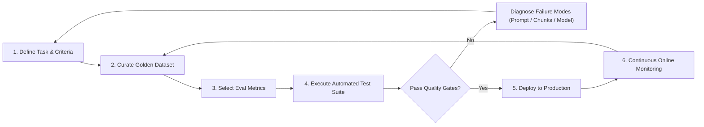
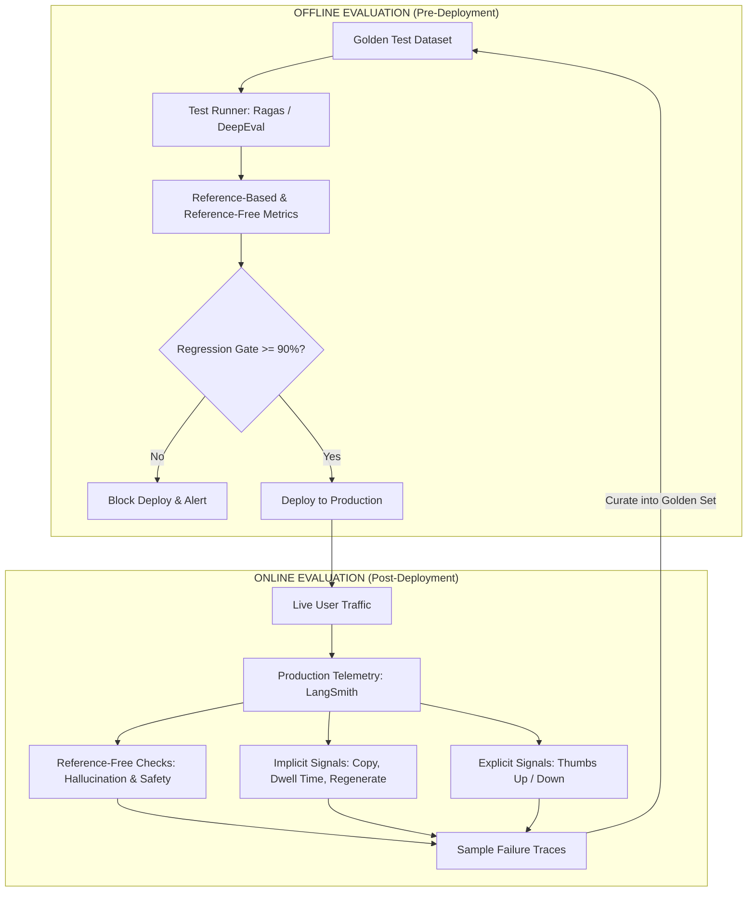
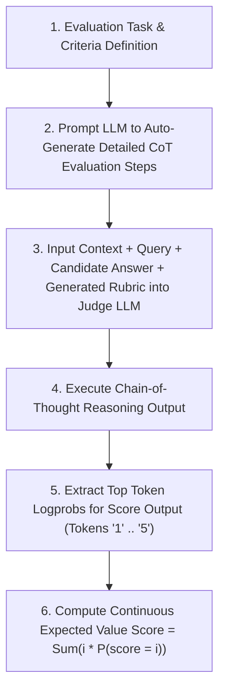

# Large Language Model (LLM) Evaluation & RAG Testing Master Notes

> **Source Material:** *LLM Evaluation Masterclass (2026 Series)* by CampusX (Nitish Singh)  
> **Course Playlist URL:** [YouTube Playlist (19 Lectures)](https://www.youtube.com/playlist?list=PLEneLIDJFpcA)  
> **Playlist ID:** `PLEneLIDJFpcA`  
> **Target File:** `topics/llm-evaluation/COMPLETE_LLM_EVALUATION_NOTES.md`  
> **Transcripts Directory:** [`topics/llm-evaluation/transcripts/`](transcripts/)  
> **Scope:** Comprehensive, production-grade guide covering the full discipline of Generative AI evaluations: shifting from "vibe checks" to metric-driven AI engineering, foundation model benchmarks vs application evaluations, RAG Triad diagnostics (Retrieval & Generation), deterministic LLM-as-a-Judge (G-Eval), safety & guardrail audits, operational latency/cost profiling, automated CI/CD regression testing, and production online telemetry with LangSmith.

---

## Table of Contents

1. [Module 1: Foundations of LLM Evaluation & System Workflow](#module-1-foundations-of-llm-evaluation--system-workflow)
   - [1.1 The Evaluation Imperative: Beyond "Vibe Checks" (Lec 01)](#11-the-evaluation-imperative-beyond-vibe-checks)
   - [1.2 Model Evals vs Application Evals (Lec 02)](#12-model-evals-vs-application-evals)
   - [1.3 The End-to-End LLM Application Evaluation Workflow (Lec 03)](#13-the-end-to-end-llm-application-evaluation-workflow)
   - [1.4 The Multi-Pipeline Architecture for Production AI (Lec 04)](#14-the-multi-pipeline-architecture-for-production-ai)
2. [Module 2: Evaluation Paradigms & Metrics Taxonomy](#module-2-evaluation-paradigms--metrics-taxonomy)
   - [2.1 Reference-Based vs Reference-Free Evaluations (Lec 05)](#21-reference-based-vs-reference-free-evaluations)
   - [2.2 LLM-as-a-Judge: Architecture, Biases & Mitigation (Lec 05)](#22-llm-as-a-judge-architecture-biases--mitigation)
   - [2.3 Offline Evals vs Online Evals: The Continuous Feedback Loop (Lec 06)](#23-offline-evals-vs-online-evals-the-continuous-feedback-loop)
3. [Module 3: Frontier Model Benchmarks, Leaderboards & Selection](#module-3-frontier-model-benchmarks-leaderboards--selection)
   - [3.1 Model Capabilities & Core Intelligence Dimensions (Lec 07)](#31-model-capabilities--core-intelligence-dimensions)
   - [3.2 Benchmark Saturation vs Data Contamination (Lec 08)](#32-benchmark-saturation-vs-data-contamination)
   - [3.3 The Evolution of AI Knowledge Benchmarks (Lec 09)](#33-the-evolution-of-ai-knowledge-benchmarks)
   - [3.4 How to Audit & Interpret LLM Leaderboards (Lec 10)](#34-how-to-audit--interpret-llm-leaderboards)
   - [3.5 Custom Model Selection & The Pareto Frontier (Lec 11)](#35-custom-model-selection--the-pareto-frontier)
4. [Module 4: RAG Evaluation Deep-Dive & The RAG Triad](#module-4-rag-evaluation-deep-dive--the-rag-triad)
   - [4.1 Answering "How Do You Evaluate Your RAG App?" in GenAI Interviews (Lec 12)](#41-answering-how-do-you-evaluate-your-rag-app-in-genai-interviews)
   - [4.2 Evaluating RAG Retrievers: Hit Rate, MRR, NDCG & Context Relevance (Lec 13)](#42-evaluating-rag-retrievers-hit-rate-mrr-ndcg--context-relevance)
   - [4.3 Evaluating RAG Generators: The Industry-Standard RAG Triad (Lec 14)](#43-evaluating-rag-generators-the-industry-standard-rag-triad)
   - [4.4 The G-Eval Framework: Deterministic LLM-as-a-Judge (Lec 15)](#44-the-g-eval-framework-deterministic-llm-as-a-judge)
5. [Module 5: Security, Guardrails & Operational Metrics](#module-5-security-guardrails--operational-metrics)
   - [5.1 Securing RAG Applications: Toxicity, PII Leakage & Scope Drift (Lec 16)](#51-securing-rag-applications-toxicity-pii-leakage--scope-drift)
   - [5.2 Operational Evaluations: Latency, Cost & Token Economics (Lec 17)](#52-operational-evaluations-latency-cost--token-economics)
6. [Module 6: Production Engineering: Regression Testing & Online Monitoring](#module-6-production-engineering-regression-testing--online-monitoring)
   - [6.1 RAG Regression Testing: Preventing Silent AI Failures (Lec 18)](#61-rag-regression-testing-preventing-silent-ai-failures)
   - [6.2 Online RAG Evaluation: Monitoring Production with LangSmith (Lec 19)](#62-online-rag-evaluation-monitoring-production-with-langsmith)

---

## Module 1: Foundations of LLM Evaluation & System Workflow

### 1.1 The Evaluation Imperative: Beyond "Vibe Checks" (Lec 01)

In early proof-of-concept development, developers rely on **"Vibe Checks"**—manually inspecting a handful of prompt responses in a playground or chat UI. While intuitive, vibe checks fail completely in production systems:
- **Non-Deterministic Outputs:** LLMs output varying completions across temperatures, seeds, and system prompt adjustments.
- **Hidden Regressions:** Tweaking a system prompt to fix one edge case frequently degrades 15% of previously working queries silently.
- **Scale Blindness:** Human inspection cannot evaluate tens of thousands of daily enterprise interactions across safety, factual accuracy, and latency.

```
       VIBE CHECKS (Hobbyist AI)               SYSTEMATIC EVALUATION (Production AI)
+------------------------------------+    +-----------------------------------------------+
|  Ad-hoc prompt experimentation     |    |  Curated Golden Datasets (50 - 500+ samples)  |
|  Manual inspection of 3-5 queries  |    |  Component-level automated scoring            |
|  Subjective "looks good" judgment  | -> |  CI/CD Automated Regression Release Gates     |
|  High risk of silent regressions   |    |  Production online telemetry & drift tracking |
+------------------------------------+    +-----------------------------------------------+
```

The core objective of **LLM Evals** is transforming generative AI development into an empirical software engineering discipline governed by quantitative assertions, reproducible test suites, and automated release gates.

---

### 1.2 Model Evals vs Application Evals (Lec 02)

| Evaluation Dimension | Model Evaluation (Model Evals) | Application Evaluation (Application Evals) |
| :--- | :--- | :--- |
| **Object Under Test** | Raw Foundation LLM checkpoint (e.g. GPT-4o, Claude 3.5 Sonnet, Llama-3-70B). | The complete **Compound AI System** (LLM + Retriever + Vector DB + System Prompts + Tools + Guardrails). |
| **Primary Audience** | AI Research Labs, Model Selectors, Infrastructure Teams. | Product AI Engineers, Application Developers, Enterprise Operators. |
| **Test Scope** | Generalized, task-agnostic capabilities (MMLU, HumanEval, GSM8K). | Domain-specific business logic, internal knowledge retrieval, and format adherence. |
| **Evaluation Environment** | Academic standardized benchmarks and public leaderboards. | Customized test benches using internal golden datasets, domain schema, and latency limits. |
| **Key Question** | *"Which base model has the strongest raw reasoning and coding capability?"* | *"Does our Course Assistant answer user queries accurately based solely on our course transcripts without leaking private data?"* |

---

### 1.3 The End-to-End LLM Application Evaluation Workflow (Lec 03)



1. **Define Task & Acceptance Criteria:** Clearly delineate input boundaries, expected persona, permitted source domains, and unacceptable failure modes (e.g., hallucination, toxic tone, out-of-scope advice).
2. **Curate Golden Test Datasets:** Assemble 50 to 500+ curated input-output pairs representing edge cases, adversarial prompts, multi-turn dialogues, and standard user queries.
3. **Select Targeted Evaluation Metrics:** Map each system requirement to measurable metrics (e.g., Hit Rate, Faithfulness, Toxicity, Token Latency).
4. **Execute Automated Evaluation Harness:** Run headless test runs across candidate prompts, retrieval chunk sizes, or model backends using automated evaluators (G-Eval, Ragas, DeepEval).
5. **Analyze Failure Distributions & Iterate:** Inspect root causes: Did the retriever fetch irrelevant chunks? Did the generator ignore context? Did prompt formatting confuse the model?
6. **Deploy & Close Feedback Loop:** Ship passing versions behind CI/CD gates; stream production traffic into online evaluation pipelines to mine edge cases that feed back into the golden dataset.

---

### 1.4 The Multi-Pipeline Architecture for Production AI (Lec 04)

Enterprise AI systems must not evaluate applications as monolithic black boxes. A failure in the final output can stem from retrieval faults, prompt truncation, or hallucination. Robust systems run multiple distinct evaluation pipelines operating in parallel:

```
                                  USER QUERY
                                      |
                    +-----------------v-----------------+
                    |  Pipeline 1: Pre-Retrieval /      |  -> Guardrail Checks:
                    |  Input Safety Evaluation          |     (Injection, Toxicity, Out-of-Scope)
                    +-----------------+-----------------+
                                      |
                    +-----------------v-----------------+
                    |  Pipeline 2: Retrieval Evaluation |  -> Retriever Checks:
                    |  (Vector DB / Hybrid Search)      |     (Hit Rate, MRR, Context Relevance)
                    +-----------------+-----------------+
                                      |
                    +-----------------v-----------------+
                    |  Pipeline 3: Generation &         |  -> Generator Checks:
                    |  Hallucination Evaluation         |     (Faithfulness, Groundedness, Answer Rel)
                    +-----------------+-----------------+
                                      |
                    +-----------------v-----------------+
                    |  Pipeline 4: Operational &        |  -> Performance Checks:
                    |  Cost Evaluation                  |     (TTFT, TPS, Cost per Call, PII Leakage)
                    +-----------------+-----------------+
                                      |
                               FINAL RESPONSE
```

---

## Module 2: Evaluation Paradigms & Metrics Taxonomy

### 2.1 Reference-Based vs Reference-Free Evaluations (Lec 05)

| Metric Class | Characteristics & Requirements | Key Metrics / Techniques | Strengths & Limitations |
| :--- | :--- | :--- | :--- |
| **Reference-Based** (Requires Ground Truth) | Requires a curated **Golden Answer** ($y^*$) to compare against candidate output ($\hat{y}$). | - Exact Match (EM)<br>- BLEU / ROUGE (N-gram overlap)<br>- BERTScore (Embedding cosine similarity)<br>- Semantic Similarity (Cross-Encoder)<br>- Reference-based LLM-as-a-Judge | **Pros:** Deterministic, reliable baseline for factual question answering.<br>**Cons:** Expensive to curate; brittle when valid alternative phrasings exist; cannot run on unlabelled live production traffic. |
| **Reference-Free** (Ground Truth Independent) | Evaluates candidate output ($\hat{y}$) purely using input context ($C$), user query ($Q$), and defined quality/safety criteria. | - Faithfulness / Groundedness<br>- Answer Relevance<br>- Toxicity & Bias Detection<br>- Hallucination Detection<br>- Structure / JSON Schema Validation | **Pros:** Highly scalable; operates directly on live production streams without human labels.<br>**Cons:** Dependent on judge LLM intelligence; vulnerable to judge hallucinations. |

---

### 2.2 LLM-as-a-Judge: Architecture, Biases & Mitigation (Lec 05)

**LLM-as-a-Judge** uses a capable frontier language model (e.g., GPT-4o, Claude 3.5 Sonnet) as an automated evaluator prompted with strict scoring rubrics, input context, and few-shot calibration examples.

#### Systematic Biases in LLM Judges & Mitigation Strategies

```
+---------------------+---------------------------------------+---------------------------------------------+
| Bias Type           | Manifestation                         | Mitigation Technique                        |
+---------------------+---------------------------------------+---------------------------------------------+
| Position Bias       | Judge favors first (or last) option   | Swap order of candidate responses:          |
|                     | in pairwise comparison evaluations.   | Score(A, B) and Score(B, A); average score. |
+---------------------+---------------------------------------+---------------------------------------------+
| Verbosity Bias      | Judge awards higher marks to longer,  | Enforce strict length normalization;        |
|                     | wordier answers regardless of quality.| explicitly penalize filler in rubric.       |
+---------------------+---------------------------------------+---------------------------------------------+
| Self-Enhancement    | Model rates completions generated by  | Use cross-family judge LLM (e.g. use Claude |
| Bias                | its own family higher than others.    | to evaluate GPT-4o outputs).                |
+---------------------+---------------------------------------+---------------------------------------------+
```

---

### 2.3 Offline Evals vs Online Evals: The Continuous Feedback Loop (Lec 06)



---

## Module 3: Frontier Model Benchmarks, Leaderboards & Selection

### 3.1 Model Capabilities & Core Intelligence Dimensions (Lec 07)

When evaluating base foundation models, engineering teams audit performance across five fundamental dimensions:
1. **Factual Reasoning & World Knowledge:** Science, humanities, and domain comprehension.
2. **Mathematical & Symbolic Logic:** Multi-step arithmetic, proof verification, algorithm synthesis.
3. **Coding & Instruction Following:** Syntactic precision, edge-case handling, complex system prompt adherence.
4. **Context Window Utilization:** "Needle In A Haystack" (NIAH) retrieval fidelity at 128k–1M+ token depths.
5. **Safety & Robustness:** Resistance to adversarial jailbreaks, low hallucination frequency under uncertainty.

---

### 3.2 Benchmark Saturation vs Data Contamination (Lec 08)

#### Benchmark Saturation
When frontier models achieve near-perfect scores on standardized benchmarks (e.g., >95% on GSM8K or MMLU), the benchmark loses its discriminatory power—it can no longer differentiate between top-tier models.

#### Data Contamination
Modern web-scraped pre-training datasets frequently ingest the test splits of public benchmarks. A model scoring high on MMLU or HumanEval may simply be reciting memorized test samples rather than exhibiting genuine generalized reasoning (**Goodhart’s Law in AI:** *"When a measure becomes a target, it ceases to be a good measure"*).

---

### 3.3 The Evolution of AI Knowledge Benchmarks (Lec 09)

```
EARLY GENERATION (Broad Knowledge)
- MMLU (Massive Multitask Language Understanding): 57 subjects, multiple choice. Highly saturated.
- GSM8K (Grade School Math 8K): Multi-step elementary school word math problems. Saturated (>95%).
- HumanEval: Python docstring to functional unit-test pass rates (Pass@1). Heavily contaminated.

FRONTIER GENERATION (Deep Reasoning & Multi-Step Logic)
- GPQA (Google-Proof Q&A): PhD-level biology, physics, and chemistry questions written by domain experts.
- MATH: High-school mathematics competition problems requiring complex LaTeX symbolic derivation.
- SWE-bench: End-to-end software engineering benchmark resolving real GitHub issues via multi-file PRs.
- LMSYS Chatbot Arena: Crowdsourced, double-blind human preference A/B tournament using Bradley-Terry Elo ratings.
```

---

### 3.4 How to Audit & Interpret LLM Leaderboards (Lec 10)

- **LMSYS Chatbot Arena:** Gold standard for real-world subjective user preference. Eliminates contamination via live blind testing, but carries bias towards agreeable tone and formatted markdown responses.
- **Hugging Face Open LLM Leaderboard 2.0:** Focuses on open-weights checkpoints across rigorous, de-contaminated subsets (IFEval, MuSR, MATH Lvl 5, GPQA).
- **Golden Rule for Engineers:** Public leaderboards narrow down the top 3–5 candidate models. Never choose your production model based purely on a public leaderboard rank—always execute **Custom In-Domain Evals**.

---

### 3.5 Custom Model Selection & The Pareto Frontier (Lec 11)

To select the optimal LLM for a domain application (e.g., enterprise Text-to-SQL or Customer Support), plot candidate models along the **Pareto Optimal Frontier**:

$$\text{Optimization Objective} = \max(\text{Task Accuracy}) \quad \text{subject to} \quad \text{Latency} \le L_{\max}, \quad \text{Cost} \le C_{\max}$$

```
    Quality / Task Accuracy (%)
        ^
    100 |                       * Model A (High Quality, High Cost, 1800ms)
        |                * Model B (Sweet Spot: 92% Acc, $0.15/1M, 420ms)
     80 |          * Model C (Fast, Inexpensive, 84% Acc)
        |
     60 |    * Model D (Sub-optimal: Lower quality, same latency as C)
        +------------------------------------------------------------>
        0                      Cost / Latency Profile
```

---

## Module 4: RAG Evaluation Deep-Dive & The RAG Triad

### 4.1 Answering "How Do You Evaluate Your RAG App?" in GenAI Interviews (Lec 12)

Top-tier interview response structure:
1. **Component-Wise Decomposition:** *"We evaluate our RAG application across two isolated layers—Retriever Evaluation and Generator Evaluation—before assessing the end-to-end pipeline."*
2. **Standardized Metrics Suite:** *"For the Retriever, we measure Hit Rate, MRR, and Context Relevance. For the Generator, we compute the RAG Triad: Context Relevance, Groundedness (Faithfulness), and Answer Relevance."*
3. **Execution Infrastructure:** *"We maintain a version-controlled Golden Dataset of 250 verified query-context-answer triples. Our evaluations run automatically in our GitHub Actions CI pipeline using G-Eval / DeepEval, blocking deployments if Faithfulness drops below 92%."*
4. **Production Observability:** *"In production, we stream traces to LangSmith, monitoring reference-free hallucination metrics and capturing negative user feedback signals to continuously expand our regression test suite."*

---

### 4.2 Evaluating RAG Retrievers (Lec 13)

Given a query $q$, ground-truth relevant document set $R_q$, and retrieved top-$K$ chunks $D_K = [d_1, d_2, \dots, d_K]$:

#### 1. Hit Rate @ K
Binary score indicating whether at least one relevant document appears in the retrieved top-$K$ results:
$$\text{Hit Rate @ } K = \begin{cases} 1 & \text{if } |D_K \cap R_q| > 0 \\ 0 & \text{otherwise} \end{cases}$$

#### 2. Mean Reciprocal Rank (MRR)
Measures where the **first** relevant chunk lands in the ranked list:
$$\text{MRR} = \frac{1}{|Q|} \sum_{i=1}^{|Q|} \frac{1}{\text{rank}_i}$$
*(If the first relevant chunk appears at position 3, the reciprocal rank is $1/3 \approx 0.333$).*

#### 3. Context Relevance
Evaluates whether the retrieved text chunks contain *only* information necessary to answer the prompt, penalizing noisy, extraneous text chunks:
$$\text{Context Relevance} = \frac{\text{Number of Sentences in Context Relevant to Query}}{\text{Total Sentences in Retrieved Context}}$$

---

### 4.3 Evaluating RAG Generators: The Industry-Standard RAG Triad (Lec 14)

Formulated by TruEra / TruLens and adopted across the industry, the **RAG Triad** isolates the three failure modes of RAG systems:

```
                          USER QUERY
                         /          \
                        /            \
        [Context Relevance]        [Answer Relevance]
                      /                \
                     v                  v
             RETRIEVED CONTEXT -------> GENERATED ANSWER
                           [Groundedness / Faithfulness]
```

#### 1. Context Relevance
- **Question Asked:** Is the retrieved context actually relevant to the user query?
- **Failure Mode:** Poor retrieval, bad embeddings, suboptimal chunk size.

#### 2. Groundedness / Faithfulness (Anti-Hallucination)
- **Question Asked:** Is every claim in the generated answer mathematically supported by the retrieved context?
- **Failure Mode:** Model hallucinating facts, ignoring provided retrieval context, reciting training weights.
$$\text{Faithfulness} = \frac{\text{Number of Claims Supported by Context}}{\text{Total Claims Extracted from Answer}}$$

#### 3. Answer Relevance
- **Question Asked:** Does the generated response directly and completely answer the user query?
- **Failure Mode:** Model going off on tangents, dodging questions, or giving polite non-answers.

---

### 4.4 The G-Eval Framework: Deterministic LLM-as-a-Judge (Lec 15)

Developed by Microsoft Research, **G-Eval** is a framework that turns non-deterministic LLM-as-a-Judge evaluations into reproducible, continuous metrics using **Chain-of-Thought (CoT)** reasoning and **Token Probability Weighting**.



#### Why G-Eval Outperforms Basic LLM Scoring Prompts
1. **CoT Formulation:** Forcing the judge to articulate explicit evaluation arguments before emitting a score improves human correlation from ~0.65 to **0.84+**.
2. **Probability Weighting:** Rather than accepting a single integer token (e.g. `3` vs `4`), G-Eval calculates the weighted mathematical expectation over output token probabilities:
   $$\text{Score} = \sum_{i=1}^{N} i \times P(\text{Score} = i)$$
   This produces a continuous, calibrated floating-point score that eliminates integer boundary variance.

---

## Module 5: Security, Guardrails & Operational Metrics

### 5.1 Securing RAG Applications: Toxicity, PII Leakage & Scope Drift (Lec 16)

Production RAG pipelines must be evaluated continuously against adversarial failure modes:

| Security Vector | Risk & Mechanism | Evaluation Assertions & Frameworks |
| :--- | :--- | :--- |
| **Prompt Injection & Jailbreaks** | Adversary embeds instructions in user prompt or unvetted external documents to hijack system instructions. | Run automated red-teaming test suites (DeepEval, PyRIT) measuring **Jailbreak Vulnerability Rate**. |
| **PII & Data Leakage** | Generator accidentally extracts and presents customer SSNs, API tokens, passwords, or employee phone numbers found in internal documents. | Regex + NER entity extraction evaluations auditing zero-PII presence in output answers. |
| **Scope / Topical Drift** | System designed as an HR benefits bot starts answering medical diagnostics, investment advice, or competitor product comparisons. | Classification judge measuring **Out-of-Domain Response Rate** (Must trigger standardized fallback message). |

---

### 5.2 Operational Evaluations: Latency, Cost & Token Economics (Lec 17)

Quality metrics are meaningless if an application is too slow or too expensive to operate at scale.

#### 1. Latency Decomposition
- **Time to First Token (TTFT):** Duration between user request submission and first streamed token render on client (target: $< 600\text{ms}$). Dominated by Prompt Token Length and Pre-fill speed.
- **Tokens per Second (TPS):** Streaming decode velocity (target: $> 40 - 80\text{ tokens/sec}$).
- **Total Request Latency:** $\text{Latency}_{\text{total}} = \text{TTFT} + \frac{\text{Generated Tokens}}{\text{TPS}} + \text{Retrieval Latency}$.

#### 2. Cost & Token Optimization
- **Prompt Caching Economics:** Architect system prompts so static knowledge headers and invariant tools occupy the cacheable prefix (Anthropic / OpenAI prompt caching offers 50%–90% cost reductions on cache hits).
- **Context Pruning / Compression:** Dynamically strip low-relevance sentences from retrieved chunks prior to injection into prompt context.

---

## Module 6: Production Engineering: Regression Testing & Online Monitoring

### 6.1 RAG Regression Testing: Preventing Silent AI Failures (Lec 18)

Every commit to an enterprise AI codebase—modifying a chunking split parameter from 500 to 800 tokens, upgrading an embedding model, or tweaking a prompt adjective—can cause silent downstream regressions.

```yaml
# Sample CI/CD Automated Regression Test Configuration (GitHub Actions)
name: RAG Evaluation Release Gate
on: [pull_request]
jobs:
  evaluate-rag:
    runs-on: ubuntu-latest
    steps:
      - uses: actions/checkout@v4
      - name: Run DeepEval Regression Test Suite
        run: |
          python -m pytest tests/test_rag_evals.py \
            --min-faithfulness=0.90 \
            --min-answer-relevance=0.85 \
            --min-hit-rate=0.92 \
            --max-cost-per-query=0.015
```

---

### 6.2 Online RAG Evaluation: Monitoring Production with LangSmith (Lec 19)

#### Online Production Monitoring Lifecycle
1. **Trace Everything:** Ingest every single LLM transaction—user prompt, system prompt, tool invocations, retrieved vector chunks, raw LLM completions, latency, and token consumption into LangSmith.
2. **Reference-Free Online Scoring:** Run lightweight, asynchronous evaluators on 5%–10% of live production volume to check for hallucinations, toxicity, and length anomalies without impacting user response latency.
3. **Capture Implicit & Explicit Feedback Signals:**
   - *Explicit:* Thumbs up / down, star ratings, flag reports.
   - *Implicit:* User copying text, immediate regeneration requests, prompt rephrasing within 30 seconds.
4. **Mine Hard Examples for the Golden Dataset:** Automatically route all traces with negative feedback or low faithfulness scores into an offline review queue to expand your CI test suite.

---
*(End of LLM Evaluation Master Reference Notes)*
