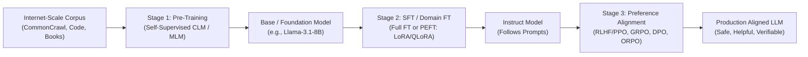

# Large Language Model (LLM) Fine-Tuning: Complete Engineering Master Notes

> **Source Material:** *Complete LLM Finetuning* by Sunny Savita  
> **Course Playlist URL:** [YouTube Playlist (33 Lectures)](https://www.youtube.com/playlist?list=PLQxDHpeGU14BX9L83JMSoKHsdIjv98BGn)  
> **Playlist ID:** `PLQxDHpeGU14BX9L83JMSoKHsdIjv98BGn`  
> **Target File:** `topics/llm-fine-tuning/COMPLETE_LLM_FINE_TUNING_NOTES.md`  
> **Transcripts Directory:** [`topics/llm-fine-tuning/transcripts/`](transcripts/) &bull; [Combined Master Transcript](transcripts/000_ALL_TRANSCRIPTS_COMBINED.txt)  
> **Scope:** End-to-end, production-grade guide covering the full LLM post-training lifecycle: pre-training vs. transfer learning, why Transformers replaced RNNs/LSTMs, Hugging Face internals, Knowledge Distillation, Quantization (PTQ, QAT, GPTQ, AWQ, GGUF/llama.cpp), the 3-stage fine-tuning pipeline (Continued Pretraining, SFT, Alignment), PEFT (LoRA, QLoRA, DoRA, IA3), Preference Optimization (RLHF/PPO, GRPO, DPO, ORPO), frameworks (LLaMA-Factory, Unsloth, Axolotl, OpenAI, Vertex AI), SLMs, Multimodal VLMs, Embedding/RAG fine-tuning, plus essential missing systems topics (VRAM math, DeepSpeed ZeRO/FSDP, RoPE/YaRN context scaling, synthetic data curation, catastrophic forgetting, adapter merging, and vLLM/SGLang serving).

---

## Table of Contents

1. [Module 1: Foundations of Model Training, Transfer Learning & Architecture Evolution](#module-1-foundations-of-model-training-transfer-learning--architecture-evolution)
   - [1.1 The LLM Lifecycle & Pre-Training Objectives (Lec 01–02)](#11-the-llm-lifecycle--pre-training-objectives)
   - [1.2 Transfer Learning vs. Fine-Tuning: CNNs, BERT & LLMs (Lec 03)](#12-transfer-learning-vs-fine-tuning-cnns-bert--llms)
   - [1.3 Decision Matrix: Prompting vs. Fine-Tuning vs. RAG vs. AI Agents (Lec 05)](#13-decision-matrix-prompting-vs-fine-tuning-vs-rag-vs-ai-agents)
   - [1.4 Why Fine-Tuning Failed in RNN/LSTM & How Transformers Changed the Game (Lec 06–07)](#14-why-fine-tuning-failed-in-rnnlstm--how-transformers-changed-the-game)
2. [Module 2: The Hugging Face Ecosystem & Classical Transformer Fine-Tuning](#module-2-the-hugging-face-ecosystem--classical-transformer-fine-tuning)
   - [2.1 Core Hugging Face Stack, Tokenizers & AutoClasses (Lec 08)](#21-core-hugging-face-stack-tokenizers--autoclasses)
   - [2.2 Evaluation Metrics: Accuracy, BLEU, ROUGE & Perplexity (Lec 08)](#22-evaluation-metrics-accuracy-bleu-rouge--perplexity)
   - [2.3 Fine-Tuning BERT for Sentiment, NER & QA (Lec 09)](#23-fine-tuning-bert-for-sentiment-ner--qa)
3. [Module 3: Model Compression — Knowledge Distillation & Quantization](#module-3-model-compression--knowledge-distillation--quantization)
   - [3.1 Knowledge Distillation: Teacher-Student, Soft Labels & DeepSeek-R1 (Lec 10–11)](#31-knowledge-distillation-teacher-student-soft-labels--deepseek-r1)
   - [3.2 Quantization Math: Data Types, Affine Mapping, PTQ & QAT (Lec 12)](#32-quantization-math-data-types-affine-mapping-ptq--qat)
   - [3.3 LLM Quantization: GPTQ, AWQ, GGML, GGUF & `llama.cpp` (Lec 13)](#33-llm-quantization-gptq-awq-ggml-gguf--llamacpp)
4. [Module 4: The 3-Stage LLM Post-Training Pipeline](#module-4-the-3-stage-llm-post-training-pipeline)
   - [4.1 Stage 1: Domain-Specific Continued Pretraining on PDF/Text Data (Lec 14, 17)](#41-stage-1-domain-specific-continued-pretraining-on-pdftext-data)
   - [4.2 Stage 2: Instruction Fine-Tuning (SFT), Chat Templates & `-100` Masking (Lec 15, 17)](#42-stage-2-instruction-fine-tuning-sft-chat-templates---100-masking)
   - [4.3 Stage 3: Preference Alignment Overview & Multi-Stage LoRA Merging Rule (Lec 16–17)](#43-stage-3-preference-alignment-overview--multi-stage-lora-merging-rule)
5. [Module 5: Parameter-Efficient Fine-Tuning (PEFT) — LoRA, QLoRA & Variants](#module-5-parameter-efficient-fine-tuning-peft--lora-qlora--variants)
   - [5.1 Low-Rank Adaptation (LoRA) Mathematics & Hyperparameters (Lec 27 + Depth)](#51-low-rank-adaptation-lora-mathematics--hyperparameters)
   - [5.2 QLoRA: NF4, Double Quantization & Paged Optimizers (Lec 27 + Missing Pillars)](#52-qlora-nf4-double-quantization--paged-optimizers)
   - [5.3 Beyond LoRA: DoRA, rsLoRA, IA3, Prefix/Prompt Tuning & Spectrum *(Added)*](#53-beyond-lora-dora-rslora-ia3-prefixprompt-tuning--spectrum)
6. [Module 6: Preference Alignment & Reinforcement Fine-Tuning](#module-6-preference-alignment--reinforcement-fine-tuning)
   - [6.1 Why SFT Is Insufficient & RL Fundamentals (Lec 28–29)](#61-why-sft-is-insufficient--rl-fundamentals)
   - [6.2 RLHF with PPO: The 4-Model Setup & Clipping (Lec 29–30)](#62-rlhf-with-ppo-the-4-model-setup--clipping)
   - [6.3 GRPO: Group Relative Policy Optimization & DeepSeekMath/R1 (Lec 31)](#63-grpo-group-relative-policy-optimization--deepseekmathr1)
   - [6.4 DPO: Direct Preference Optimization (Lec 32)](#64-dpo-direct-preference-optimization)
   - [6.5 ORPO: Odds Ratio Preference Optimization & SimPO/KTO (Lec 33)](#65-orpo-odds-ratio-preference-optimization--simpokto)
   - [6.6 Head-to-Head Comparison: PPO vs. GRPO vs. DPO vs. ORPO](#66-head-to-head-comparison-ppo-vs-grpo-vs-dpo-vs-orpo)
7. [Module 7: Fine-Tuning Frameworks & Managed Cloud Platforms](#module-7-fine-tuning-frameworks--managed-cloud-platforms)
   - [7.1 Top Open-Source Frameworks Landscape (Lec 04)](#71-top-open-source-frameworks-landscape)
   - [7.2 LLaMA-Factory: LlamaBoard WebUI & YAML CLI (Lec 18)](#72-llama-factory-llamaboard-webui--yaml-cli)
   - [7.3 Unsloth: Custom Triton/CUDA Kernels & 2x–4x Speedups (Lec 19)](#73-unsloth-custom-tritoncuda-kernels--2x4x-speedups)
   - [7.4 Axolotl: Low-Code YAML, Multipacking & Liger Kernel (Lec 20)](#74-axolotl-low-code-yaml-multipacking--liger-kernel)
   - [7.5 Managed APIs: OpenAI GPT Fine-Tuning & Google Vertex AI Gemini (Lec 21–22)](#75-managed-apis-openai-gpt-fine-tuning--google-vertex-ai-gemini)
8. [Module 8: Specialized Modalities — SLMs, Multimodal VLMs & Embeddings](#module-8-specialized-modalities--slms-multimodal-vlms--embeddings)
   - [8.1 Small Language Models (SLMs) for Edge & Agentic AI (Lec 23)](#81-small-language-models-slms-for-edge--agentic-ai)
   - [8.2 Multimodal Vision-Language Model (VLM) Fine-Tuning (Lec 24)](#82-multimodal-vision-language-model-vlm-fine-tuning)
   - [8.3 Embedding & RAG Retrieval Fine-Tuning + Matryoshka (MRL) (Lec 25–26 + MRL)](#83-embedding--rag-retrieval-fine-tuning--matryoshka-mrl)
9. [Module 9: Systems Engineering — VRAM Math, Distributed Training, Context & Data *(Added Missing Topics)*](#module-9-systems-engineering--vram-math-distributed-training-context--data)
   - [9.1 First-Principles VRAM & Compute Budgeting](#91-first-principles-vram--compute-budgeting)
   - [9.2 Distributed Multi-GPU Training: DDP, DeepSpeed ZeRO & FSDP](#92-distributed-multi-gpu-training-ddp-deepspeed-zero--fsdp)
   - [9.3 Context Window Extension: RoPE, NTK-Aware Scaling & YaRN](#93-context-window-extension-rope-ntk-aware-scaling--yarn)
   - [9.4 Data Engineering, Synthetic Pipelines & Contamination Audits](#94-data-engineering-synthetic-pipelines--contamination-audits)
10. [Module 10: Post-Training Evaluation, Forgetting, Merging & Production Serving *(Added Missing Topics)*](#module-10-post-training-evaluation-forgetting-merging--production-serving)
    - [10.1 Catastrophic Forgetting, Alignment Tax & NEFTune](#101-catastrophic-forgetting-alignment-tax--neftune)
    - [10.2 Evaluating Fine-Tuned Models (`lm-eval`, Loss Curves & Overfitting)](#102-evaluating-fine-tuned-models-lm-eval-loss-curves--overfitting)
    - [10.3 Adapter Merging (SLERP, TIES, DARE) & Multi-LoRA Serving](#103-adapter-merging-slerp-ties-dare--multi-lora-serving)
    - [10.4 Production Inference: vLLM, SGLang, GGUF Sizing & Speculative Decoding](#104-production-inference-vllm-sglang-gguf-sizing--speculative-decoding)

---

## Module 1: Foundations of Model Training, Transfer Learning & Architecture Evolution

### 1.1 The LLM Lifecycle & Pre-Training Objectives

Modern Large Language Models (LLMs) are not built in a single training run. They follow a multi-stage lifecycle where **self-supervised pre-training** creates broad world knowledge and **post-training** shapes behavior, domain expertise, and safety.



- **Self-Supervised vs. Unsupervised Pre-Training:** Pre-training is often loosely called "unsupervised," but it is technically **self-supervised learning**: the training targets ($y$) are automatically derived from the unlabeled text itself without human annotation.
- **Core Pre-Training Objectives:**
  1. **Causal Language Modeling (CLM / Autoregressive):** Predict the next token $P(x_t \mid x_{<t})$ using a causal attention mask. Used by decoder-only LLMs (**GPT, LLaMA, Mistral, DeepSeek, Qwen, Gemma**).
  2. **Masked Language Modeling (MLM):** Randomly mask ~15% of tokens (`[MASK]`) and predict them from bidirectional context. Used by encoder-only models (**BERT, RoBERTa, DeBERTa**).
  3. **Span Masking / Denoising:** Mask contiguous spans of text and reconstruct them in an encoder-decoder setup (**T5, BART**).

---

### 1.2 Transfer Learning vs. Fine-Tuning: CNNs, BERT & LLMs

- **Transfer Learning** reuses representations learned on a source task (e.g., ImageNet 14M images or internet text) as the starting point for a target task.
- **Fine-Tuning** is the active adaptation step—updating some or all of those transferred parameters (or newly attached heads) on downstream data.

| Paradigm | Feature Hierarchy / Mechanics | Standard Fine-Tuning Strategy |
| :--- | :--- | :--- |
| **CNNs** (`VGG16`, `ResNet`) | Early layers extract edges/textures; deep layers extract object parts. | Freeze early conv blocks; replace classification head (`include_top=False`) and optionally unfreeze top block (`block5_*`). |
| **Classical Encoders** (`BERT`, `RoBERTa`) | 12–24 bidirectional Transformer blocks (`768`/`1024` hidden dim). | Full FT with small LR (`2e-5`–`5e-5`) + task head (`ForSequenceClassification`, `ForTokenClassification`), or freeze base and tune last $k$ layers. |
| **Modern Decoder LLMs** (`LLaMA`, `Qwen`, `Mistral`) | Billions of parameters (`RMSNorm`, `SwiGLU`, `GQA`, `RoPE`). | Unfreezing full blocks is VRAM-prohibitive on single GPUs; use **PEFT** (LoRA/QLoRA/DoRA) + quantization. |

---

### 1.3 Decision Matrix: Prompting vs. Fine-Tuning vs. RAG vs. AI Agents

Every GenAI system places an LLM at its core, but choosing the right adaptation mechanism depends on whether the problem is **knowledge freshness**, **behavioral/format specialization**, or **autonomous action**:

| Dimension | Prompt Engineering | Fine-Tuning | RAG (Retrieval-Augmented Generation) | AI Agents |
| :--- | :--- | :--- | :--- | :--- |
| **Core Mechanism** | In-context instructions & few-shot examples | Updating model weights / adapters on curated data | Dynamic retrieval from Vector/Hybrid DB into prompt | LLM (Brain: plan, memory, observe) + Tools (APIs, DBs, code) |
| **Best For** | Rapid prototyping, general tasks | Tone, strict output schema, domain jargon, latency/cost reduction (distilling to SLMs) | Private, fast-changing, or real-time facts; verifiable citations | Multi-step workflows, external side-effects (sending emails, querying SQL) |
| **Knowledge Cutoff** | Bound to pre-training | Static at training time | Real-time / live | Real-time via tools |
| **Cost Profile** | High per-token prompt cost if few-shot is long | Upfront training cost; low inference cost (especially with SLMs) | Embedding + Vector DB infra + retrieval latency | Multi-turn LLM calls per task |

> [!TIP]
> **Production Hybrid Pattern (Agentic RAG + Fine-Tuning):** Fine-tune a compact open-source model (e.g., 7B–8B or SLM) for domain terminology, tool-calling syntax, and embedding retrieval, connect it to a RAG pipeline for live private facts, and orchestrate actions via an agent loop.

---

### 1.4 Why Fine-Tuning Failed in RNN/LSTM & How Transformers Changed the Game

Before 2017, **ULMFiT (2018)** proved that pre-trained LSTMs could be fine-tuned for text classification, yet RNN/LSTM fine-tuning failed to generalize at scale:
1. **Sequential Bottleneck:** Hidden state $h_t = f(h_{t-1}, x_t)$ requires step-by-step computation, preventing parallel GPU utilization over trillion-token corpora.
2. **Vanishing Gradients & Short Memory:** Vanilla RNNs lose context beyond ~10–15 words; LSTMs extend this via cell state + Forget/Input/Output gates to ~30–100 words, still far short of long documents.
3. **Task & Objective Mismatch:** Repurposing a Many-to-One sentiment LSTM into an Async Many-to-Many encoder-decoder causes severe **catastrophic forgetting** and out-of-vocabulary (OOV) failures.

**How the Transformer (Vaswani et al., 2017) Solved It:**
- **Parallel Ingestion + Positional Encoding:** Processes all tokens simultaneously while injecting order via positional encodings.
- **Scaled Dot-Product Self-Attention:** Connects every token to every other token in $O(1)$ path length:
  $$\text{Attention}(Q, K, V) = \text{softmax}\left(\frac{QK^T}{\sqrt{d_k}}\right)V$$
- **Residual Connections + LayerNorm/RMSNorm:** Stabilizes deep gradient flow across dozens of layers.
- **Universal Architecture:** Enabled standardized foundation backbones (`BERT`, `GPT`, `T5`, `LLaMA`) with modular task heads and PEFT adapters.

---

## Module 2: The Hugging Face Ecosystem & Classical Transformer Fine-Tuning

### 2.1 Core Hugging Face Stack, Tokenizers & AutoClasses

```
+-------------------------------------------------------------------+
|                   HUGGING FACE TRAINING STACK                     |
+-------------------+-------------------+---------------------------+
| Data & Tokenization| Modeling & Heads  | Optimization & Alignment  |
| - datasets        | - transformers    | - peft (LoRA, DoRA, IA3)  |
| - tokenizers(Rust)| - AutoModel*      | - bitsandbytes (4/8-bit)  |
| - fsspec          | - AutoConfig      | - accelerate (DDP/FSDP)   |
| - streaming=True  | - safetensors     | - trl (SFT, DPO, PPO, GRPO)|
+-------------------+-------------------+---------------------------+
```

- **Hugging Face vs. LangChain:** Hugging Face is the **model/dataset hub & training/optimization ecosystem** (`transformers`, `datasets`, `peft`, `trl`, `evaluate`); LangChain is an **application orchestration layer** that consumes HF endpoints or local `HuggingFacePipeline` models.
- **Fast Tokenizers (`use_fast=True`):** Backed by Rust (`tokenizers`), achieving ~2x+ throughput over Python tokenizers. Produces `input_ids` (e.g., `[CLS]=101`, `[SEP]=102`), `attention_mask`, and optional `token_type_ids`.
- **Training a Custom BPE Tokenizer:** Uses `Tokenizer(models.BPE())` $\to$ `pre_tokenizers.Whitespace()` $\to$ `trainers.BpeTrainer(vocab_size=...)` $\to$ `train_from_iterator()`, wrapped in `PreTrainedTokenizerFast`.
- **AutoClasses:**
  - `AutoModel`: Returns raw `last_hidden_state` `[batch, seq_len, hidden_dim]` (mean-pooling yields dense embeddings).
  - Task Heads: `AutoModelForSequenceClassification`, `AutoModelForTokenClassification` (NER/POS), `AutoModelForQuestionAnswering`, `AutoModelForMaskedLM`, `AutoModelForCausalLM`.

### 2.2 Evaluation Metrics: Accuracy, BLEU, ROUGE & Perplexity

| Metric | Primary Task | Mathematical / Conceptual Basis | Interpretation |
| :--- | :--- | :--- | :--- |
| **Accuracy / F1** | Classification, NER | Exact label match; precision/recall harmonic mean | Standard for discriminative tasks |
| **BLEU** | Machine Translation | Modified $1\text{–}4$ gram **precision** + brevity penalty | Higher is better ($0\text{–}1$ or $0\text{–}100$) |
| **ROUGE** (`1`, `2`, `L`) | Summarization | $n$-gram & Longest Common Subsequence (LCS) **recall** | Measures content overlap with reference |
| **Perplexity (PPL)** | Causal LM / Pretraining | $\text{PPL} = \exp(\mathcal{L}_{\text{CE}})$ | Lower is better: `10–30` strong, `30–50` acceptable, `>100` confused |

### 2.3 Fine-Tuning BERT for Sentiment, NER & QA

Despite generative LLMs, encoder-only models (`BERT`, `RoBERTa`, `DeBERTa`, `XLM-RoBERTa`) remain production staples for low-latency (<10 ms) classification, PII/NER extraction, and dense retrieval.
- **Workflow with `Trainer`:**
  1. Load dataset (`datasets.load_dataset`), tokenize with `padding="max_length"`, `truncation=True`, rename `label` $\to$ `labels`, and call `.set_format("torch")`.
  2. Load `BertForSequenceClassification.from_pretrained("bert-base-uncased", num_labels=k)`.
  3. Train with `TrainingArguments` + `Trainer` (optionally freezing `model.bert` and tuning only `encoder.layer[-2:]`, `pooler`, and `classifier`).
  4. Push artifacts to Hub with `push_to_hub()` or serve via `pipeline("text-classification")`.

---

## Module 3: Model Compression — Knowledge Distillation & Quantization

### 3.1 Knowledge Distillation: Teacher-Student, Soft Labels & DeepSeek-R1

Introduced by Hinton et al. (2015), **Knowledge Distillation (KD)** transfers "dark knowledge" from a large, slow **Teacher** model into a compact **Student** model.

- **Hard vs. Soft Labels:**
  - **Hard Labels ($y$):** One-hot ground truth (e.g., `[1, 0, 0]`).
  - **Soft Labels:** Temperature-scaled softmax probabilities $\sigma(z / T)$ from the Teacher (e.g., `[0.70, 0.20, 0.10]`), revealing inter-class similarities. Increasing temperature $T > 1$ flattens the distribution to expose richer dark knowledge.
- **Distillation Loss:**
  $$\mathcal{L}_{\text{KD}} = \alpha \, \mathcal{L}_{\text{CE}}\big(y_{\text{hard}},\, \text{softmax}(z_S)\big) + (1 - \alpha)\, T^2 \, \mathcal{L}_{\text{KL}}\big(\text{softmax}(z_T / T) \,\|\, \text{softmax}(z_S / T)\big)$$
  *(Multiplying the KL term by $T^2$ preserves gradient magnitude because softmax gradients scale by $1/T^2$).*
- **Key Industry Milestones:**
  - **DistilBERT:** 40% fewer parameters, 60% faster inference, retains 97% of BERT's performance.
  - **Distilling Step-by-Step:** A 770M T5 student outperformed 540B PaLM using 80% of the data by distilling rationales.
  - **DeepSeek-R1 Distillation (2025):** Reasoning traces from `DeepSeek-R1` (trained via SFT + GRPO) were distilled into smaller `Qwen` and `LLaMA` checkpoints, giving small models strong chain-of-thought reasoning without running expensive RL on every size.
- **Practical Gotcha:** Loading both FP16 Teacher (`phi-2`) and Student (`phi-1_5`) simultaneously exhausts 15 GB T4 VRAM; in practice, pre-compute and cache teacher logits (or synthetic completions) offline before training the student.

---

### 3.2 Quantization Math: Data Types, Affine Mapping, PTQ & QAT

Quantization maps high-precision floating-point weights/activations to lower-bit representations to slash VRAM, increase memory-bandwidth throughput, and enable CPU/edge inference.

| Data Type | Bits | Bytes / Param | 7B Model Size | Primary Role |
| :--- | :---: | :---: | :---: | :--- |
| `FP32` | 32 | 4.0 | ~28 GB | Master optimizer weights, FP32 training |
| `FP16` / `BF16` | 16 | 2.0 | ~14 GB | Standard LLM mixed-precision training & inference (`BF16` has FP32 exponent range, preventing overflow) |
| `FP8` | 8 | 1.0 | ~7 GB | H100/Ada Tensor Core high-throughput training & inference |
| `INT8` | 8 | 1.0 | ~7 GB | Standard integer PTQ/QAT (`[-128, 127]`) |
| `NF4` (NormalFloat4) | 4 | 0.5 | ~3.5 GB | Information-theoretically optimal 4-bit bins for normally distributed weights (QLoRA) |
| `INT4` | 4 | 0.5 | ~3.5 GB | Ultra-compact inference (`[-8, 7]`) |

**Affine Quantization Equations:**
$$x_q = \text{clamp}\left(\text{round}\left(\frac{x}{S}\right) + Z,\; Q_{\min},\; Q_{\max}\right), \qquad \hat{x} = (x_q - Z) \cdot S$$
$$S = \frac{R_{\max} - R_{\min}}{Q_{\max} - Q_{\min}}, \qquad Z = \begin{cases} 0 & \text{Symmetric (centered at 0, } [-128, 127]\text{)} \\ -\text{round}(R_{\min}/S) & \text{Asymmetric (shifted range)} \end{cases}$$

**PTQ vs. QAT Taxonomy:**
- **Dynamic PTQ:** Weights quantized statically offline; activations quantized dynamically on-the-fly at inference. Zero calibration data required.
- **Static PTQ:** Quantizes both weights and activations using a small **calibration dataset** to record activation min/max ranges via forward hooks.
- **QAT (Quantization-Aware Training):** Inserts `FakeQuantize` nodes during forward passes using the **Straight-Through Estimator (STE)** so gradients remain FP32 while the model adapts to rounding noise. Highest accuracy, highest training cost.

---

### 3.3 LLM Quantization: GPTQ, AWQ, GGML, GGUF & `llama.cpp`

Small networks use per-tensor quantization; LLMs require **per-channel (row-wise) or group-wise** (e.g., `group_size=128`) quantization because outlier channels vary by orders of magnitude.

| Format / Method | Calibration Needed? | Key Mechanism | Primary Ecosystem / Target |
| :--- | :---: | :--- | :--- |
| **GPTQ** (2022) | Yes (50–200 samples) | Minimizes $\min_{\hat{W}}\|WX - \hat{W}X\|_F^2$ using inverse Hessian $H = X^T X$ and error propagation to unquantized weights | GPU inference (`gptqmodel`, `vLLM`, `SGLang`, Marlin/ExLlamaV2 kernels) |
| **AWQ** (2023) | Yes | **Activation-aware Weight Quantization**: protects ~1% salient weights corresponding to large activation magnitudes via per-channel scaling; no Hessian | Fast GPU `W4A16` inference (`vLLM`, `llmcompressor`) |
| **bitsandbytes (`NF4`)** | No (zero-shot) | Quantile-based 4-bit NormalFloat quantization on-the-fly | QLoRA fine-tuning (`transformers` + `peft`) |
| **GGUF** (`llama.cpp`) | No (optional imatrix) | Single-file binary bundling weights (`Q4_0`, `Q4_K_M`, `Q5_K_M`, `Q8_0`) + tokenizer + RoPE metadata (replaces legacy **GGML** `.bin`) | CPU, Apple Silicon (Metal), hybrid CPU+GPU offloading (`llama.cpp`, `Ollama`, `LM Studio`) |

---

## Module 4: The 3-Stage LLM Post-Training Pipeline

### 4.1 Stage 1: Domain-Specific Continued Pretraining on PDF/Text Data

Base models lack private enterprise vocabulary (e.g., proprietary pharma compounds, internal codebases). **Continued Pretraining (CPT)**—non-instructional SFT—teaches domain terminology and statistical distribution before instruction tuning.
- **Pipeline:** Extract raw text (`PyMuPDF` / `fitz`) $\to$ clean & chunk paragraphs respecting context limits $\to$ tokenize into `{"text": ...}` chunks with `labels = input_ids.copy()` and `pad_token = eos_token` $\to$ train causal next-token prediction via 4-bit/8-bit LoRA (`TinyLlama-1.1B` / `Llama-3.1-8B`).
- **Standard CPT Datasets:** `HuggingFaceFW/fineweb`, `openwebtext`, `TinyStories`.

### 4.2 Stage 2: Instruction Fine-Tuning (SFT), Chat Templates & `-100` Masking

A domain-adapted base model only *completes* text; it does not *answer* instructions. **SFT** teaches prompt-following using structured `(instruction, input, output)` or `messages` (`system`, `user`, `assistant`) pairs.
- **Standard Schemas:**
  - **Alpaca:** `{"instruction": "...", "input": "...", "output": "..."}`
  - **ShareGPT:** `{"conversations": [{"from": "human", "value": "..."}, {"from": "gpt", "value": "..."}]}`
  - **ChatML / OpenAI Messages:** `{"messages": [{"role": "system"|"user"|"assistant", "content": "..."}]}`
- **Response-Only Loss Masking (`-100`):** In PyTorch `CrossEntropyLoss`, `ignore_index=-100` skips loss calculation on prompt/instruction tokens so the model is penalized *only* on assistant response tokens—preventing wasted capacity memorizing user prompts.

### 4.3 Stage 3: Preference Alignment Overview & Multi-Stage LoRA Merging Rule

Even SFT models can output rude, verbose, or unsafe advice. Stage 3 aligns outputs to human preferences (**Helpful, Honest, Harmless**) using `(prompt, chosen, rejected)` triplets.

> [!CAUTION]
> **Critical Multi-Stage LoRA Rule (Never Stack Unmerged LoRAs!):**  
> Calling `get_peft_model()` directly on top of an unmerged LoRA checkpoint (`Base -> LoRA_1 -> LoRA_2`) destabilizes training and causes severe repetition/hallucinations.  
> **Correct Pattern:** Load Base Model $\to$ `PeftModel.from_pretrained(base, ckpt)` $\to$ call **`.merge_and_unload()`** to bake $\Delta W_1$ into $W_0$ $\to$ attach a fresh `get_peft_model(merged, new_lora_config)` for the next stage.

---

## Module 5: Parameter-Efficient Fine-Tuning (PEFT) — LoRA, QLoRA & Variants

### 5.1 Low-Rank Adaptation (LoRA) Mathematics & Hyperparameters

Introduced by Hu et al. (2021), **LoRA** freezes pretrained weights $W_0 \in \mathbb{R}^{d \times k}$ and injects trainable low-rank decomposition matrices $B \in \mathbb{R}^{d \times r}$ and $A \in \mathbb{R}^{r \times k}$ where rank $r \ll \min(d, k)$:

$$h = W_0 x + \Delta W x = W_0 x + \frac{\alpha}{r} B A x$$

- **Initialization:** $A \sim \mathcal{N}(0, \sigma^2)$ and $B = 0$, ensuring $\Delta W = BA = 0$ at step 0 so training starts identically to the pretrained model.
- **Parameter Savings:** For a $4096 \times 4096$ matrix ($16.77\text{M}$ params) with $r=16$: $A + B = (16 \times 4096) + (4096 \times 16) = 131\text{K}$ params (**0.78%** of original). In GPT-3 (175B), LoRA trained only 4.7M parameters.
- **Key Hyperparameters (`LoraConfig`):**
  - `r` (Rank): `8, 16, 32, 64` (higher rank = more capacity for complex domains/coding, more VRAM).
  - `lora_alpha`: Scaling numerator; common rule of thumb is `lora_alpha = 2 * r` (e.g., `r=16, alpha=32`) or `alpha = r`.
  - `target_modules`: Applying LoRA to **all linear layers** (`q_proj, k_proj, v_proj, o_proj, gate_proj, up_proj, down_proj`) matches Full FT quality far better than attention-only (`q_proj, v_proj`).
  - `lora_dropout`: `0.0` (required for Unsloth kernel fast-paths) or `0.05`.

### 5.2 QLoRA: NF4, Double Quantization & Paged Optimizers

**QLoRA** (Dettmers et al., 2023) enables fine-tuning 65B models on a single 48 GB GPU (or 7B–8B models on a 16 GB T4) via **three core innovations** (only NF4 is covered in Lec 27; the other two are essential pillars):

1. **4-bit NormalFloat (`NF4`):** An information-theoretically optimal 4-bit data type for zero-mean normally distributed neural weights—each quantization bin contains an equal expected number of weights. Weights are stored in `NF4` and dequantized to `BF16`/`FP16` (`bnb_4bit_compute_dtype`) only during forward/backward matmuls.
2. **Double Quantization *(Added)*:** Quantizes the FP32 quantization scaling constants themselves (`FP32 -> FP8` with blocksize 256), reducing quantization metadata overhead from ~0.5 bits/param to ~0.127 bits/param (saving ~3 GB on a 65B model).
3. **Paged Optimizers *(Added)*:** Uses NVIDIA Unified Memory to automatically page `AdamW` optimizer states between GPU VRAM and CPU RAM whenever long-sequence activation spikes threaten OOM.

### 5.3 Beyond LoRA: DoRA, rsLoRA, IA3, Prefix/Prompt Tuning & Spectrum *(Added)*

| PEFT Method | Mechanism | Key Advantage / Tradeoff |
| :--- | :--- | :--- |
| **DoRA** (Weight-Decomposed LoRA) | Decomposes $W = m \frac{V}{\|V\|_c}$ into scalar magnitude $m$ and direction $V + BA$. | Mimics Full FT learning dynamics; consistently outperforms LoRA at low ranks (+1–3% accuracy) with tiny overhead. |
| **rsLoRA** (Rank-Stabilized LoRA) | Replaces scaling $\frac{\alpha}{r}$ with $\frac{\alpha}{\sqrt{r}}$. | Prevents gradient collapse at high ranks ($r \ge 64$), allowing rank scaling to improve performance. |
| **IA3** (Infused Adapter by Inhibiting & Amplifying Inner Activations) | Learns 3 rescaling vectors ($l_k, l_v, l_{ff}$) multiplying keys, values, and FFN activations. | ~100× fewer params than LoRA; zero inference latency; great for few-shot tasks. |
| **Prefix / Prompt Tuning** | Prepends learnable virtual soft tokens to input embeddings or every attention layer's $K, V$. | Easy multi-tenant batching, but consumes context window and underperforms LoRA on complex reasoning. |
| **BitFit** | Trains only bias terms $b$ across the network. | Extremely lightweight, limited expressiveness (many modern LLMs omit biases). |
| **Spectrum** | Ranks layers by Signal-to-Noise Ratio (SNR) of weight matrices and full-tunes only the top 25–50% layers. | Often beats QLoRA on reasoning without adapter overhead. |

---

## Module 6: Preference Alignment & Reinforcement Fine-Tuning

### 6.1 Why SFT Is Insufficient & RL Fundamentals

SFT only maximizes the likelihood of positive examples $(x, y^+)$; it provides **no negative gradient** against plausible-sounding hallucinations, sycophancy, or unsafe advice. Preference alignment teaches the model *relative preference* ($y^+ \succ y^-$).

In RL framing for LLMs: **Agent/Policy** = LLM $\pi_\theta(a_t \mid s_t)$; **State** = prompt + generated tokens so far; **Action** = next token sampled from vocab (~32k–128k tokens); **Reward** = scalar score at end of response. Value-based methods (Q-Learning, DQN) fail because enumerating $Q(s, a)$ over 100k+ tokens per step is intractable, necessitating **Policy Gradient / Actor-Critic** methods.

### 6.2 RLHF with PPO: The 4-Model Setup & Clipping

Introduced in OpenAI's *InstructGPT*, **RLHF (PPO)** requires **4 models in memory simultaneously**:
1. **Policy Model ($\pi_\theta$, Actor):** Trainable LLM generating completions.
2. **Reference Model ($\pi_{\text{ref}}$):** Frozen SFT copy enforcing a **KL divergence penalty** $\beta \, D_{\text{KL}}(\pi_\theta \| \pi_{\text{ref}})$ so the policy doesn't hack the reward model with gibberish.
3. **Reward Model ($R_\phi$):** Frozen `AutoModelForSequenceClassification` trained beforehand on human `(prompt, chosen, rejected)` pairs using pairwise ranking loss. *(PPO never queries humans directly; it queries $R_\phi$).*
4. **Value Model ($V_\psi$, Critic):** Estimates expected future reward; computes Advantage $A_t = R_{\text{actual}} - V_{\text{expected}}$.

**PPO Clipped Objective:** Bounds the probability ratio $r_t(\theta) = \frac{\pi_\theta(a_t|s_t)}{\pi_{\theta_{\text{old}}}(a_t|s_t)}$ within $[1-\epsilon, 1+\epsilon]$ (typically $\epsilon = 0.2 \implies [0.8, 1.2]$) so policy updates stay "proximal" and stable.

### 6.3 GRPO: Group Relative Policy Optimization & DeepSeekMath/R1

Introduced in **DeepSeekMath** (2024) and powering **DeepSeek-R1** (2025), **GRPO** eliminates the heavy Value/Critic model completely:
- For each prompt $x$, the policy samples a **group** of $G$ candidate completions $\{o_1, o_2, \dots, o_G\}$.
- Each completion receives a scalar reward $r_i$—either from a Reward Model **or** from **verifiable rule-based functions (RLVR)** (e.g., exact math answer extraction, Python unit-test pass/fail, XML `<think>` format checks).
- **Group Relative Advantage:** Normalizes each reward against the group's mean and standard deviation:
  $$A_i = \frac{r_i - \text{mean}(\{r_1, \dots, r_G\})}{\text{std}(\{r_1, \dots, r_G\})}$$
- Cuts RL VRAM/compute nearly in half compared to PPO while excelling at math, code, and multi-step reasoning.

### 6.4 DPO: Direct Preference Optimization

**DPO** (Rafailov et al., 2023) proves mathematically that the optimal RLHF policy has a closed-form relationship to the reward function, eliminating **both** the Reward Model and online RL sampling. It uses **2 models** ($\pi_\theta$ and frozen $\pi_{\text{ref}}$, or a single model with `ref_model=None` via PEFT adapter toggling) and optimizes a supervised binary cross-entropy objective on offline `(prompt, chosen, rejected)` pairs:

$$\mathcal{L}_{\text{DPO}}(\pi_\theta; \pi_{\text{ref}}) = -\mathbb{E}_{(x, y_w, y_l)} \left[ \log \sigma \left( \beta \log \frac{\pi_\theta(y_w \mid x)}{\pi_{\text{ref}}(y_w \mid x)} - \beta \log \frac{\pi_\theta(y_l \mid x)}{\pi_{\text{ref}}(y_l \mid x)} \right) \right]$$

- **Key Diagnostic Metrics (`DPOTrainer`):** Watch `rewards/accuracies` (should trend toward `> 0.7–0.9`) and `rewards/margins` ($\text{chosen} - \text{rejected}$ should steadily increase).

### 6.5 ORPO: Odds Ratio Preference Optimization & SimPO/KTO

**ORPO** (Hong et al., KAIST, 2024) merges **Stage 2 (SFT) + Stage 3 (Alignment)** into **one monolithic stage** with **only 1 model** (no Reference Model, no Reward Model, no Critic):

$$\mathcal{L}_{\text{ORPO}} = \mathcal{L}_{\text{SFT}} + \lambda \cdot \mathcal{L}_{\text{OR}}, \qquad \text{Odds}(y \mid x) = \frac{P(y \mid x)}{1 - P(y \mid x)}$$
$$\mathcal{L}_{\text{OR}} = -\log \sigma \left( \log \frac{\text{Odds}(y_w \mid x)}{\text{Odds}(y_l \mid x)} \right)$$

- **Other Reference-Free / Alternative Methods:**
  - **SimPO *(Added)*:** Uses length-normalized average log-probability with a target reward margin $\gamma$, avoiding length bias and eliminating $\pi_{\text{ref}}$.
  - **KTO (Kahneman-Tversky Optimization):** Requires only binary thumbs-up/thumbs-down signals (`desirable` vs. `undesirable`) instead of paired `(chosen, rejected)` completions.

### 6.6 Head-to-Head Comparison: PPO vs. GRPO vs. DPO vs. ORPO

| Method | Models in Memory | Online Generation? | Reward Source | Training Stage | Primary Production Sweet Spot |
| :--- | :---: | :---: | :--- | :--- | :--- |
| **PPO (RLHF)** | 4 (Policy, Ref, Reward, Critic) | Yes (Slowest) | Trained Reward Model | Post-SFT | Frontier general chat alignment |
| **GRPO** | 3 (or 2 with rule rewards: Policy, Ref) | Yes (Group of $G$) | Rule/Verifiable functions or RM | Post-SFT | Math, coding, agentic reasoning (`DeepSeek-R1`) |
| **DPO** | 2 (Policy, frozen Ref) | No (Offline pairs) | Implicit via log-prob ratio | Post-SFT | Industry workhorse for general preference tuning |
| **ORPO** | **1** (Policy only) | No (Offline pairs) | Odds Ratio + SFT NLL | **Single-stage** (SFT + Align) | Memory-constrained single-GPU alignment |

---

## Module 7: Fine-Tuning Frameworks & Managed Cloud Platforms

### 7.1 Top Open-Source Frameworks Landscape

- **Tier 1 (Core Workhorses):** **Hugging Face** (`transformers`, `peft`, `trl`, `accelerate`, `bitsandbytes`), **Unsloth**, **LLaMA-Factory**, **Axolotl**, **DeepSpeed**.
- **Tier 2 (Specialized / Serving):** **Colossal-AI**, **LightLLM**, **vLLM**, **SGLang**.
- **Tier 3 (Orchestration):** **SkyPilot** (multi-cloud GPU spot/cluster orchestration), **OpenLLM**, **FastChat**.

### 7.2 LLaMA-Factory: LlamaBoard WebUI & YAML CLI

All-in-one wrapper (`hiyouga/LLaMA-Factory`) supporting Pretraining, SFT, DPO, PPO, KTO, Full/Freeze/LoRA/QLoRA/OFT, BNB/HQQ/EETQ quantization, RoPE scaling (`linear`, `dynamic`, `YaRN`, `llama3`), and DeepSpeed.
- **Data Registration:** Custom datasets (Alpaca, ShareGPT, DPO) must be registered in `data/dataset_info.json`.
- **Two Modes:** **LlamaBoard** (`src/webui.py` Gradio UI for no-code experimentation, chat, and export) and **CLI** (`llamafactory-cli train config.yaml`, `eval`, `export`, `api`).

### 7.3 Unsloth: Custom Triton/CUDA Kernels & 2x–4x Speedups

Drop-in optimization layer (`FastLanguageModel`, `FastVisionModel`) achieving **2x–4x faster training** and **50%–80% less VRAM** with exact mathematical equivalence:
- Replaces PyTorch autograd overhead with **manual backpropagation**, **fused Attention + MLP OpenAI Triton kernels**, `use_gradient_checkpointing="unsloth"`, **FlashAttention-2**, and **sequence packing** (`packing=True`).
- Hosts 1,150+ pre-quantized 4-bit models (`unsloth/` org) and exports directly to `GGUF` (`llama.cpp`), `Ollama`, `vLLM`, and `SGLang`.

### 7.4 Axolotl: Low-Code YAML, Multipacking & Liger Kernel

Production-oriented, YAML-driven post-training engine (`axolotl-ai`) with Docker/cloud support:
- Built-in **Multipacking** (eliminates padding waste), **FlashAttention / FlexAttention**, **Liger Kernel** (LinkedIn's fused C++/Triton kernels), **Cut Cross Entropy** (avoids materializing full `[batch*seq, vocab]` FP32 logit tensors), and **DeepSpeed / FSDP / Ray** multi-node scaling.

### 7.5 Managed APIs: OpenAI GPT Fine-Tuning & Google Vertex AI Gemini

| Feature | OpenAI Fine-Tuning API | Google Gemini (Vertex AI) |
| :--- | :--- | :--- |
| **Platform** | OpenAI Dashboard / Python SDK | GCP **Vertex AI** + GCS Bucket (`gs://...`) *(AI Studio FT deprecated)* |
| **JSONL Format** | `{"messages": [{"role": "system"|"user"|"assistant", "content": "..."}]}` | `{"systemInstruction": ..., "contents": [{"role": "user"|"model", "parts": [{"text": "..."}]}]}` |
| **Min Examples** | 10 minimum (50–100+ recommended) | 16–100+ recommended |
| **Methods** | SFT, Vision FT, DPO, Reinforcement FT | SFT (LoRA / Full), RLHF, DPO |
| **Cost Drivers** | Compute $/hr + training tokens + higher inference token rate | Per-1M training tokens (e.g., Flash-Lite $1.50, Flash $5, Pro $25) + endpoint hosting |

---

## Module 8: Specialized Modalities — SLMs, Multimodal VLMs & Embeddings

### 8.1 Small Language Models (SLMs) for Edge & Agentic AI

**SLMs** ($\le 10\text{B}$ parameters: `SmolLM2-135M/1.7B`, `TinyLlama-1.1B`, `Qwen2.5-0.5B/1.5B/3B`, `Gemma-2B`, `Phi-3/4 Mini`, `DeepSeek-R1-Distill-1.5B`) offer **10x–30x lower cost** and sub-100ms latency.
- **Agentic Routing Architecture (*SLMs are the Future of Agentic AI*):** Most agentic steps are narrow, repetitive, format-constrained tool calls or JSON extractions. Route 80–90% of subtasks to fine-tuned SLMs and escalate only complex open-ended reasoning to frontier LLMs.

### 8.2 Multimodal Vision-Language Model (VLM) Fine-Tuning

Modern VLMs (`Qwen2-VL / Qwen2.5-VL`, `LLaVA`, `Llama-3.2-Vision`, `Pixtral`, `Gemma-3`) pair a **Vision Encoder** (ViT splitting images into $16\times 16$ patches, CLIP/SigLIP) + **Projection/Connector** (MLP or Cross-Attention) + **LLM Decoder**.
- **Fine-Tuning Strategy:** Standard PEFT attaches LoRA adapters to both the **Vision layers** and **LLM attention/MLP layers** (`FastVisionModel.get_peft_model`) using `UnslothVisionDataCollator`.
- **Dataset Formats:** Simple `(image, caption)`, VQA `(image, question, answer)`, or conversational `messages` containing `{"type": "image"}` + `{"type": "text"}` (e.g., `LaTeX OCR`, `ChartQA`).

### 8.3 Embedding & RAG Retrieval Fine-Tuning + Matryoshka (MRL)

General embeddings (`all-mpnet-base-v2`, `BGE`, `E5`) often miss domain-specific acronyms and semantic relationships in RAG.

```
BI-ENCODER / DUAL ENCODER (Fast First-Stage Retrieval)
  Query  --> [Encoder] --> q_vec --\
                                     --> Cosine Sim(q_vec, d_vec)  [Pre-compute doc vectors in FAISS/Qdrant]
  Doc    --> [Encoder] --> d_vec --/

CROSS-ENCODER (High-Accuracy Reranker)
  [CLS] Query [SEP] Doc [SEP] --> [Transformer] --> Relevance Score (0..1)  [Cannot pre-compute]
```

- **Training Data & Losses (`sentence-transformers`):**
  - **Pairs (`anchor`, `positive`):** Trained with **`MultipleNegativesRankingLoss` (MNRL / InfoNCE)**, treating all other positives in the batch as in-batch negatives (larger batch size = stronger contrast).
  - **Triplets (`anchor`, `positive`, `negative`):** Trained with **Triplet Loss** $\max(0, \text{sim}(q, d^-) - \text{sim}(q, d^+) + m)$ (mining **hard negatives**—documents lexically similar to the query but factually wrong—gives the largest RAG Recall@k jump).
- **Matryoshka Representation Learning (MRL) *(Added)*:** Wrapping MNRL in `MatryoshkaLoss(model, loss, matryoshka_dims=[768, 512, 256, 128, 64])` trains the first $k$ dimensions to capture coarse semantics, allowing you to truncate vectors at inference time to slash Vector DB RAM by 4x–6x with <2% accuracy loss.
- **Benchmarking:** Evaluate before/after fine-tuning using **`mteb`** (STSBenchmark, BEIR, Retrieval Recall@k, NDCG@10).

---

## Module 9: Systems Engineering — VRAM Math, Distributed Training, Context & Data *(Added Missing Topics)*

### 9.1 First-Principles VRAM & Compute Budgeting

Understanding memory math prevents OOMs before launching a run. For a model with $\Phi$ parameters (in billions):

$$\text{Total VRAM} = \text{Weights} + \text{Gradients} + \text{Optimizer States} + \text{Activations/KV Cache}$$

1. **Mixed-Precision Full Fine-Tuning (`AdamW` in `FP16`/`BF16`):**
   - Weights (`BF16`): $2\Phi$ GB
   - Gradients (`BF16`): $2\Phi$ GB
   - Optimizer States (`FP32` master weights + `FP32` momentum $m$ + `FP32` variance $v$): $4\Phi + 4\Phi + 4\Phi = 12\Phi$ GB
   - **Static Memory Minimum:** **$16\Phi$ GB** (+ activations). A **7B model** requires $16 \times 7 = \mathbf{112\text{ GB}}$ just for static states ($\ge 2\times\text{A100 80GB}$)!
2. **LoRA (`BF16` base, 1% trainable params):**
   - Frozen Weights: $2\Phi$ GB (~14 GB for 7B); Gradients + Optimizer only on $0.01\Phi$ (~0.16 GB) + Activations $\implies$ **~18–22 GB**.
3. **QLoRA (`NF4` base, 1% trainable params):**
   - Frozen 4-bit Weights: $0.5\Phi$ GB (~3.5 GB for 7B) + Double-Quant constants + LoRA states (~0.2 GB) + Activations $\implies$ **~6–8 GB** (fits on a free 15 GB T4 or 8 GB consumer GPU!).

**Memory-Saving Levers:**
- **Gradient Checkpointing:** Discards intermediate activations during forward pass and recomputes them during backward pass (~25–30% slower step time, cuts activation VRAM by 60–80%).
- **Gradient Accumulation:** Simulates large effective batch sizes ($\text{Batch}_{\text{eff}} = \text{micro\_batch} \times \text{grad\_accum} \times \text{num\_gpus}$) without holding large activation tensors.
- **FlashAttention-2 / 3:** IO-aware SRAM tiling computes exact attention in $O(N)$ memory instead of $O(N^2)$, unlocking long-context training.

### 9.2 Distributed Multi-GPU Training: DDP, DeepSpeed ZeRO & FSDP

When a single GPU cannot hold the model or batch, distribute across $N$ GPUs:

| Strategy | What Is Sharded Across $N$ GPUs? | Communication Overhead | When to Use |
| :--- | :--- | :--- | :--- |
| **DDP** (Distributed Data Parallel) | Data batches only (full model replicated on every GPU) | Low (All-Reduce gradients) | Model fits comfortably on 1 GPU; scaling throughput |
| **DeepSpeed ZeRO-1** | Optimizer States ($1/N$) | Same as DDP | Moderate memory savings with zero slowdown |
| **DeepSpeed ZeRO-2** | Optimizer States + Gradients ($1/N$) | Same as DDP | Standard multi-GPU LoRA / medium Full FT |
| **DeepSpeed ZeRO-3 / PyTorch FSDP** | Optimizer States + Gradients + **Model Parameters** ($1/N$) | Higher (All-Gather weights per layer) | Training 70B+ Full FT across nodes (+ **ZeRO-Offload** to CPU RAM/NVMe) |
| **Tensor / Pipeline Parallelism (TP/PP)** | Intra-layer matrix slices (TP) or layer groups (PP) | Very high (requires NVLink for TP) | Pre-training / massive 70B–405B clusters (`Megatron-LM`) |

### 9.3 Context Window Extension: RoPE, NTK-Aware Scaling & YaRN

Most open models use **RoPE (Rotary Position Embeddings)**, which encodes relative distance by rotating $Q$ and $K$ vectors in 2D subspaces at frequencies $\theta_i = b^{-2i/d}$ (base $b = 10{,}000$ or $500{,}000$). Feeding sequences longer than pre-trained context (e.g., 32k on an 8k model) causes perplexity explosion.
- **Linear Position Interpolation (PI):** Scales all positions down by $L / L'$ (e.g., $t' = t / 4$). Loses high-frequency local resolution; requires brief fine-tuning.
- **NTK-Aware Scaling:** Increases the rotary base $b$ dynamically so high-frequency local components are preserved while low-frequency global components stretch.
- **YaRN (Yet another RoPE extensioN):** Combines NTK-by-parts frequency interpolation with attention temperature scaling ($1/\sqrt{t}$), achieving 64k–128k+ context with minimal fine-tuning steps (supported natively in `LLaMA-Factory` and `Unsloth`).

### 9.4 Data Engineering, Synthetic Pipelines & Contamination Audits

- **LIMA Principle (*Less Is More for Alignment*):** 1,000 carefully curated, diverse, noise-free examples consistently beat 50,000 scraped noisy examples for instruction alignment.
- **Synthetic Data Generation:**
  - **Self-Instruct / Evol-Instruct (`WizardLM`):** Iteratively prompt a frontier teacher LLM to evolve seed instructions (adding constraints, reasoning depth, edge cases).
  - **Rejection Sampling / Best-of-N:** Sample $N$ completions from a model, filter with a verifier or Reward Model, and keep only verified trajectories for SFT.
- **Hygiene Checklist Before Training:**
  1. **Deduplication:** Run exact + MinHash LSH / semantic deduplication to prevent memorization and evaluation inflation.
  2. **PII Scrubbing:** Strip emails, API keys, SSNs, and phone numbers (`Presidio`).
  3. **Contamination Check:** Check $n$-gram overlap (e.g., 13-gram) against public benchmarks (`MMLU`, `GSM8K`, `HumanEval`) so eval scores aren't artificially inflated.
  4. **Chat Template & EOS Audit:** Always use `tokenizer.apply_chat_template()` and verify the `eos_token` (`<|eot_id|>`, `<|im_end|>`, `</s>`) is appended—missing EOS tokens cause infinite generation loops at inference.

---

## Module 10: Post-Training Evaluation, Forgetting, Merging & Production Serving *(Added Missing Topics)*

### 10.1 Catastrophic Forgetting, Alignment Tax & NEFTune

Fine-tuning on narrow domain data can erode general reasoning, coding, or safety guardrails (**Catastrophic Forgetting** / **Alignment Tax**).
- **Mitigations:**
  1. **Data Replay / Mixing:** Mix **5%–15% general instruction data** (e.g., `OpenOrca`, `SlimOrca`, `Tulu`) into domain SFT batches.
  2. **Conservative Learning Rates:** Use `1e-4` to `2e-4` for LoRA/QLoRA and `1e-5` to `2e-5` for Full FT with cosine decay and 3–5% warmup.
  3. **PEFT Regularization:** Lower rank $r$, higher weight decay, or `EWC` (Elastic Weight Consolidation) penalizing drift on high-Fisher-information weights.
  4. **NEFTune (Noisy Embedding Fine-Tuning):** Adding uniform random noise $\mathcal{U}(-\alpha/\sqrt{Ld}, +\alpha/\sqrt{Ld})$ to token embeddings during SFT significantly reduces overfitting and boosts conversational quality (built into `trl.SFTConfig(neftune_noise_alpha=5)`).

### 10.2 Evaluating Fine-Tuned Models (`lm-eval`, Loss Curves & Overfitting)

- **Reading Loss Curves:**
  - *Training loss drops, validation loss rises:* Overfitting (reduce epochs—1 to 3 epochs is standard for SFT—increase dropout, or add replay data).
  - *Both losses plateau high:* LR too low, LoRA rank too small, or `target_modules` omitted MLP layers.
- **Automated Benchmarking:**
  - **General Retention:** Run EleutherAI's `lm-evaluation-harness` (`MMLU`, `GSM8K`, `HellaSwag`, `HumanEval`) before and after FT to quantify forgetting.
  - **Domain & Format Evaluation:** Use a curated Golden Eval Set (50–500 examples) scored via **LLM-as-a-Judge (G-Eval)**, deterministic JSON schema validators, or unit tests.

### 10.3 Adapter Merging (SLERP, TIES, DARE) & Multi-LoRA Serving

Beyond `model.merge_and_unload()` (which fuses a single LoRA into $W_0$ with zero inference overhead), **`mergekit`** enables combining multiple specialized models without retraining:
- **SLERP (Spherical Linear Interpolation):** Smoothly interpolates weights along a sphere between two models (preserves weight norms better than linear averaging).
- **TIES-Merging:** Resolves task-vector sign conflicts (`+` vs. `-` weight deltas) via Trim $\to$ Elect Sign $\to$ Disjoint Merge.
- **DARE (Drop And REscale):** Randomly drops 90%+ of delta parameters and rescales the remainder before merging, eliminating interference across multiple fine-tuned experts.
- **Multi-LoRA Serving:** Engines like **vLLM** and **LoRAX** keep one frozen base model in VRAM and dynamically swap/batch dozens of lightweight LoRA adapters per incoming API request.

### 10.4 Production Inference: vLLM, SGLang, GGUF Sizing & Speculative Decoding

| Engine | Core Optimization | Best Use Case |
| :--- | :--- | :--- |
| **vLLM** | **PagedAttention** (non-contiguous KV-cache paging) + Continuous Batching + Multi-LoRA | High-throughput GPU API serving (OpenAI-compatible) |
| **SGLang** | **RadixAttention** (automatic KV-cache prefix tree reuse) + Constrained JSON decoding | Agentic loops, multi-turn chat, structured outputs |
| **llama.cpp / Ollama** | `GGUF` CPU/Metal/hybrid offloading | Local/edge deployment, MacBooks, privacy-first desktops |

- **Choosing a GGUF Quantization:** `Q4_K_M` is the universal sweet spot (~4.85 bits/weight, near-FP16 quality, ~4.5 GB for 7B–8B); `Q5_K_M` / `Q6_K` for higher precision; `Q8_0` for near-lossless serving.
- **Speculative Decoding:** Pair your **fine-tuned SLM** (e.g., 1B draft model) with a **large verifier LLM** (e.g., 70B); the SLM drafts $k$ tokens rapidly and the 70B model verifies all $k$ in one forward pass, yielding **2x–3x faster lossless generation**.
