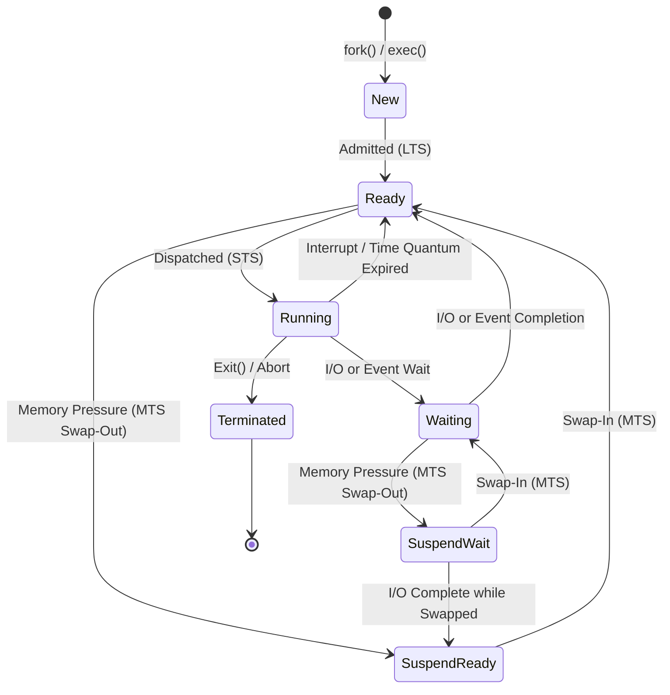

# Operating Systems: Complete Academic & Systems Engineering Master Notes

> **Source Material:** *Operating System (Complete Playlist)* by Knowledge Gate (Sanchit Jain)  
> **Course Playlist URL:** [YouTube Playlist (92 Lectures)](https://www.youtube.com/playlist?list=PLxCzCOWd7aiGz9donHRrE9I3Mwn6XdP8p)  
> **Playlist ID:** `PLxCzCOWd7aiGz9donHRrE9I3Mwn6XdP8p`  
> **Target File:** `topics/operating-system/COMPLETE_OPERATING_SYSTEM_NOTES.md`  
> **Raw Video Transcripts:** [92 Lecture Transcripts](transcripts/) &bull; [Combined Master Transcript](transcripts/000_ALL_TRANSCRIPTS_COMBINED.txt)  
> **Scope:** Comprehensive master curriculum covering fundamental OS architectures, dual-mode kernel mechanics, CPU scheduling, concurrency and process synchronization, deadlocks, virtual memory and paging, secondary storage scheduling, file system implementation, UNIX inodes, and system security.

---

## Table of Contents

1. [Module 1: OS Architecture, Types, Process Management & System Calls](#module-1-os-architecture-types-process-management--system-calls)
   - [1.1 Syllabus Overview & Foundational OS Concepts (Lec 0, 1.1)](#11-syllabus-overview--foundational-os-concepts)
   - [1.2 Historical Evolution & Types of Operating Systems (Lec 1.2 – 1.4)](#12-historical-evolution--types-of-operating-systems)
   - [1.3 Process Lifecycle & Queuing Models (Lec 1.5)](#13-process-lifecycle--queuing-models)
   - [1.4 Essential Linux System Commands (Lec 1.6)](#14-essential-linux-system-commands)
   - [1.5 System Calls & Dual-Mode Kernel Protection (Lec 1.7, 1.10)](#15-system-calls--dual-mode-kernel-protection)
   - [1.6 The `fork()` System Call Deep Dive & Process Trees (Lec 1.8, 1.9)](#16-the-fork-system-call-deep-dive--process-trees)
   - [1.7 Threads: Process vs Thread & ULT vs KLT (Lec 1.11, 1.12)](#17-threads-process-vs-thread--ult-vs-klt)
2. [Module 2: CPU Scheduling Algorithms & Multiprogramming Metrics](#module-2-cpu-scheduling-algorithms--multiprogramming-metrics)
   - [2.1 Preemption vs Non-Preemption & Core Metrics (Lec 2.1, 2.2)](#21-preemption-vs-non-preemption--core-metrics)
   - [2.2 First-Come First-Served (FCFS) & Convoy Effect (Lec 2.3)](#22-first-come-first-served-fcfs--convoy-effect)
   - [2.3 Shortest Job First (SJF) & Shortest Remaining Time First (SRTF) (Lec 2.4 – 2.6)](#23-shortest-job-first-sjf--shortest-remaining-time-first-srtf)
   - [2.4 Round Robin (RR) Scheduling & Quantum Calibration (Lec 2.7)](#24-round-robin-rr-scheduling--quantum-calibration)
   - [2.5 Priority Scheduling & Starvation Mitigation (Lec 2.8)](#25-priority-scheduling--starvation-mitigation)
   - [2.6 Mixed CPU and I/O Burst Workloads (Lec 2.9)](#26-mixed-cpu-and-io-burst-workloads)
   - [2.7 Multi-Level Queue (MLQ) & Multi-Level Feedback Queue (MLFQ) (Lec 2.10, 2.11)](#27-multi-level-queue-mlq--multi-level-feedback-queue-mlfq)
3. [Module 3: Process Synchronization, Classic Concurrency Problems & Semaphores](#module-3-process-synchronization-classic-concurrency-problems--semaphores)
   - [3.1 Race Conditions & Critical Section Problem Criteria (Lec 3.1, 3.4)](#31-race-conditions--critical-section-problem-criteria)
   - [3.2 Classical Synchronization Pitfalls (Producer-Consumer & Printer-Spooler) (Lec 3.2, 3.3)](#32-classical-synchronization-pitfalls)
   - [3.3 Software & Hardware Solutions (Lock, Test-and-Set, Turn Variable) (Lec 3.5 – 3.7)](#33-software--hardware-solutions)
   - [3.4 Semaphores: Counting & Binary Semaphores (Lec 3.8 – 3.10)](#34-semaphores-counting--binary-semaphores)
   - [3.5 Classical Synchronization Problems Solved (Lec 3.11 – 3.13)](#35-classical-synchronization-problems-solved)
4. [Module 4: Deadlocks: Principles, Resource Allocation Graphs, Prevention & Avoidance](#module-4-deadlocks-principles-resource-allocation-graphs-prevention--avoidance)
   - [4.1 Coffman Conditions & Deadlock Characterization (Lec 4.1)](#41-coffman-conditions--deadlock-characterization)
   - [4.2 Resource Allocation Graphs (Single & Multi-Instance) (Lec 4.2, 4.3)](#42-resource-allocation-graphs)
   - [4.3 Handling Strategies & Deadlock Prevention (Lec 4.4)](#43-handling-strategies--deadlock-prevention)
   - [4.4 Deadlock Avoidance: The Banker’s Algorithm (Lec 4.5 – 4.8)](#44-deadlock-avoidance-the-bankers-algorithm)
5. [Module 5: Memory Management, Paging, Virtual Memory & Page Replacement](#module-5-memory-management-paging-virtual-memory--page-replacement)
   - [5.1 Contiguous Memory Allocation & Partitioning (Lec 5.1 – 5.7)](#51-contiguous-memory-allocation--partitioning)
   - [5.2 Paging Mechanics & Address Translation (Lec 5.8 – 5.11)](#52-paging-mechanics--address-translation)
   - [5.3 Page Table Structures, Multilevel Paging & Inverted Tables (Lec 5.12 – 5.15)](#53-page-table-structures-multilevel-paging--inverted-tables)
   - [5.4 Thrashing, Segmentation & Overlays (Lec 5.16 – 5.18)](#54-thrashing-segmentation--overlays)
   - [5.5 Virtual Memory, Demand Paging & TLB Access Calculations (Lec 5.19 – 5.21, Lec 90)](#55-virtual-memory-demand-paging--tlb-access-calculations)
   - [5.6 Page Replacement Algorithms & Belady’s Anomaly (Lec 5.22 – 5.26)](#56-page-replacement-algorithms--beladys-anomaly)
6. [Module 6: Secondary Storage Structure & Disk Scheduling Algorithms](#module-6-secondary-storage-structure--disk-scheduling-algorithms)
   - [6.1 Hard Disk Architecture & Access Latency Components (Lec 6.1, 6.2)](#61-hard-disk-architecture--access-latency-components)
   - [6.2 Disk Scheduling Algorithms: FCFS, SSTF, SCAN, LOOK, C-SCAN, C-LOOK (Lec 6.3 – 6.10)](#62-disk-scheduling-algorithms)
7. [Module 7: File Systems Organization, Allocation Methods & Unix Inode Architecture](#module-7-file-systems-organization-allocation-methods--unix-inode-architecture)
   - [7.1 File Concepts, Attributes & Operations (Lec 7.1, 7.2)](#71-file-concepts-attributes--operations)
   - [7.2 File Allocation Techniques (Contiguous, Linked, Indexed) (Lec 7.3 – 7.6)](#72-file-allocation-techniques)
   - [7.3 Unix Inode Internal Architecture & Capacity Calculations (Lec 7.7)](#73-unix-inode-internal-architecture--capacity-calculations)
8. [Module 8: System Protection, Security, Program Execution Lifecycle & Interview Playbook](#module-8-system-protection-security-program-execution-lifecycle--interview-playbook)
   - [8.1 Protection & Security Domains (Lec 8)](#81-protection--security-domains)
   - [8.2 Program Lifecycle: Linkers and Loaders (Lec 92)](#82-program-lifecycle-linkers-and-loaders)
   - [8.3 High-Yield Placement & Competitive Exam Questions (Lec 91)](#83-high-yield-placement--competitive-exam-questions)

---

## Module 1: OS Architecture, Types, Process Management & System Calls

### 1.1 Syllabus Overview & Foundational OS Concepts

An Operating System (OS) is system software that acts as an intermediary between computer hardware and computer users. It manages system resources (CPU, Memory, Storage, I/O devices) and provides an abstract, convenient execution environment for application software.

```
+-------------------------------------------------------+
|                    End Users                          |
+-------------------------------------------------------+
|          Application Software (Browser, IDE, DB)      |
+-------------------------------------------------------+
|         System Software / Utilities (Shell, GUI)       |
+-------------------------------------------------------+
|                 Operating System Kernel               |
|  [ Process Mgr | Memory Mgr | File Mgr | Device Mgr ] |
+-------------------------------------------------------+
|                    Hardware                           |
|           [ CPU | RAM | Disk | Network | I/O ]        |
+-------------------------------------------------------+
```

#### Dual Goals of an Operating System
1. **Convenience / User-Friendliness:** Abstract physical hardware complexity (e.g., exposing high-level file system read/write operations instead of raw magnetic disk cylinder head sector tracking). Primary goal for Desktop and Consumer OS (Windows, macOS, Android).
2. **Efficiency / Throughput:** Maximize resource utilization, CPU throughput, and minimize turnaround latency. Primary goal for Mainframe, Server, and Cloud infrastructure OS (Linux, Unix).

---

### 1.2 Historical Evolution & Types of Operating Systems

| OS Paradigm | Core Operating Mechanics | Primary Advantage | Major Limitation / Bottleneck |
| :--- | :--- | :--- | :--- |
| **Batch OS** | Jobs with similar requirements grouped into batches by an operator; executed sequentially without user interaction. | High hardware utilization compared to single-user manual setups. | Lack of interaction; CPU idle during I/O operations; no priority scheduling. |
| **Multiprogrammed OS** | Multiple processes kept in Main Memory simultaneously; when the current process blocks on I/O, the CPU switches to another ready process. | High CPU utilization; maximizes Degree of Multiprogramming. | No guaranteed user response time; non-interactive; complex memory isolation required. |
| **Multitasking (Time-Sharing) OS** | CPU executes multiple jobs by switching among them rapidly using a fixed Time Quantum (Round Robin preemptive scheduling). | Real-time interactive response; users share CPU illusion of dedicated access. | High context switching overhead; complex scheduling & virtual memory requirements. |
| **Real-Time OS (RTOS)** | Strict deadlines on task completion. Subtypes: **Hard RTOS** (missing deadline causes total catastrophe, e.g., pacemaker, missile guidance) vs **Soft RTOS** (performance degrades gracefully, e.g., video streaming). | Predictable, deterministic latency guarantees; minimal jitter. | Low throughput; restrictive resource allocation; little multitasking flexibility. |
| **Distributed OS** | Loosely coupled computation across autonomous nodes communicating over network fabric; presents single-system image. | Fault tolerance, resource pooling, dynamic scalability. | Network partition hazards; complex distributed synchronization and consensus. |
| **Clustered OS** | Closely coupled physical systems sharing common storage (SAN/NAS) and clustered interconnects (Asymmetric vs Symmetric). | High availability (HA), automated failover, load balancing. | High storage infrastructure cost; cluster lock manager synchronization overhead. |
| **Embedded OS** | Ultra-compact kernel tailored for specialized microcontrollers (IoT, automotive ECUs, appliances). | Minimal footprint (KBs to MBs), power efficient, highly robust. | Minimal runtime reconfigurability; strict memory & compute constraints. |

---

### 1.3 Process Lifecycle & Queuing Models

A **Process** is a program in execution. It includes the Program Counter (PC), registers, stack (local variables, function frames), heap (dynamically allocated memory), and data segment (global/static variables).

#### The 7-State Process Transition Model



#### Process Control Block (PCB) Attributes
The PCB is the kernel data structure representing an active process:
- **Process ID (PID):** Unique integer identifier.
- **Process State:** Current state (New, Ready, Running, Waiting, Terminated).
- **Program Counter (PC):** Address of next machine instruction to execute.
- **CPU Registers:** Accumulator, index registers, stack pointer, condition codes.
- **CPU Scheduling Info:** Priority, scheduling queue pointers.
- **Memory-Management Info:** Page tables, segment tables, base/limit registers.
- **Accounting Info:** CPU time consumed, clock elapsed, time limits.
- **I/O Status Info:** List of allocated I/O devices, open file descriptor table.

#### Schedulers Compared

| Dimension | Long-Term Scheduler (LTS) | Short-Term Scheduler (STS) | Medium-Term Scheduler (MTS) |
| :--- | :--- | :--- | :--- |
| **Common Name** | Job Scheduler | CPU Scheduler | Swapper |
| **Operating Location** | Disk (Job Pool) $\to$ Main Memory | Ready Queue $\to$ CPU | Main Memory $\leftrightarrow$ Secondary Disk Swap |
| **Invocation Frequency** | Infrequent (seconds/minutes) | Extremely Frequent (milliseconds, 10–100ms) | Intermediate (hundreds of ms/seconds) |
| **Primary Goal** | Controls **Degree of Multiprogramming**; balances I/O-bound vs CPU-bound mix | Selects next process to achieve high throughput and low turnaround time | Reduces memory pressure by swapping suspended processes to disk swap |
| **Speed Requirement** | Can afford deliberate decision-making | Must be ultra-fast (measured in microseconds) | Balanced latency |

> **Context Switch & Dispatcher:**  
> The **Dispatcher** is the module that gives control of the CPU to the process selected by the Short-Term Scheduler. It performs:
> 1. Context switching (saving state of outgoing process into its PCB; restoring state of incoming process from its PCB).
> 2. Switching to user mode.
> 3. Jumping to the proper location in the user program to restart execution.  
> **Dispatch Latency** is the pure overhead time required by the dispatcher to stop one process and start another. During dispatch latency, the CPU performs zero user computation.

---

### 1.4 Essential Linux System Commands

```bash
# Process Inspection & Management
ps aux                  # Snapshot of all running processes with PID, CPU%, MEM%, TTY, STAT
top                     # Real-time interactive process viewer showing CPU/memory utilization
htop                    # Enhanced interactive process tree explorer
kill -9 <PID>           # Send SIGKILL (uninterceptable termination)
kill -15 <PID>          # Send SIGTERM (graceful termination signal)
nice -n -10 <cmd>       # Run command with higher scheduling priority (requires root)
renice +5 -p <PID>      # Alter priority of an existing running process

# Memory & Storage Diagnostics
free -h                 # Display physical RAM and swap space utilization in human-readable units
vmstat 1 5              # Virtual memory statistics (procs, memory, swap, io, system, cpu)
df -h                   # Disk filesystem usage and mount points
du -sh /path/to/dir     # Disk space consumed by directory

# IPC & Network Diagnostics
ipcs -a                 # Report inter-process communication facilities (message queues, semaphores, shared mem)
lsof -i :8080           # List open files and network sockets on port 8080
strace -p <PID>         # Trace system calls and signals issued by process
```

---

### 1.5 System Calls & Dual-Mode Kernel Protection

To protect system integrity from malicious or buggy user code, computer hardware enforces **Dual-Mode Operation** via a hardware **Mode Bit**:
- **User Mode (Mode Bit = 1):** Unprivileged. Direct hardware access and privileged CPU instructions (e.g., `HLT`, disabling interrupts, modifying page tables) are forbidden.
- **Kernel / Supervisor Mode (Mode Bit = 0):** Privileged. Full execution access to entire instruction set and all memory regions.

```
       USER MODE (Mode Bit = 1)                KERNEL MODE (Mode Bit = 0)
+------------------------------------+    +------------------------------------+
|  User Application (e.g. read())    |    |                                    |
|         |                          |    |                                    |
|         v                          |    |                                    |
|  C Library Wrapper                 |    |                                    |
|  - Load Syscall Number into EAX/RAX|    |                                    |
|  - Execute Software Interrupt /    |    |                                    |
|    Trap Instruction (syscall / int)|    |                                    |
+---------|--------------------------+    +------------------------------------+
          | Trap / Exception (Hardware Mode Bit set to 0)
          +-----------------------------------> System Call Interrupt Handler
                                                - Lookup sys_call_table[RAX]
                                                - Execute kernel function (sys_read)
                                                - Store result
          <-----------------------------------+ IRET / SYSRET (Mode Bit set to 1)
+---------|--------------------------+    +------------------------------------+
|  Return control to User Program    |    |                                    |
+------------------------------------+    +------------------------------------+
```

#### System Call Categories
1. **Process Control:** `fork()`, `execve()`, `wait()`, `exit()`, `abort()`, `getpid()`.
2. **File Manipulation:** `open()`, `read()`, `write()`, `close()`, `lseek()`, `unlink()`.
3. **Device Management:** `ioctl()`, `read()`, `write()`.
4. **Information Maintenance:** `gettimeofday()`, `alarm()`, `sleep()`.
5. **Communication / IPC:** `pipe()`, `shmget()`, `mmap()`, `socket()`, `connect()`.

---

### 1.6 The `fork()` System Call Deep Dive & Process Trees

`fork()` creates an exact clone of the calling parent process:
- Returns `0` to the newly spawned child process.
- Returns the **Child's PID (>0)** to the parent process.
- Returns `< 0` if fork fails (e.g., system process table exhausted).

#### Copy-on-Write (COW)
Modern operating systems do not physically copy the parent's memory pages on `fork()`. Instead:
- Parent and child share the identical physical memory pages marked **read-only**.
- Only when either process attempts a write operation does the MMU trigger a page-fault trap, causing the OS to allocate a private physical page and perform the copy.

#### Calculation of Process Trees
For $n$ consecutive unconditional `fork()` calls:
$$\text{Total Processes Generated} = 2^n$$
$$\text{Child Processes Created} = 2^n - 1$$

```c
#include <stdio.h>
#include <unistd.h>

int main() {
    // 3 successive forks generate 2^3 = 8 processes (1 root parent + 7 children)
    fork();
    fork();
    fork();
    printf("Process PID: %d, Parent PPID: %d\n", getpid(), getppid());
    return 0;
}
```

#### Zombie vs Orphan Processes
- **Zombie Process:** A child process that has completed execution (`exit()`), but its exit status has not yet been read by its parent via `wait()`. It consumes no CPU or RAM, but occupies an entry in the OS Process Table.
- **Orphan Process:** A child process whose parent terminated without calling `wait()`. In Linux, the orphan process is immediately adopted by `init` / `systemd` (PID 1), which periodically invokes `wait()` to reap terminated children.

---

### 1.7 Threads: Process vs Thread & ULT vs KLT

A **Thread** (or Lightweight Process, LWP) is the smallest unit of CPU scheduling. Multiple threads belonging to the same process share:
- Code Segment (Text)
- Data Segment (Globals)
- Heap (Dynamic memory)
- Open File Descriptors and Network Sockets

Each thread maintains its own private:
- Thread ID (TID)
- Program Counter (PC)
- Register Set
- Thread Stack (Local variables, call stack)

```
        PROCESS ADDRESS SPACE
+------------------------------------+
|           Code (Text)              | <--- Shared by all Threads
+------------------------------------+
|           Data (Globals)           | <--- Shared by all Threads
+------------------------------------+
|               Heap                 | <--- Shared by all Threads
+------------------------------------+
|  Thread 1 Stack | Thread 2 Stack   | <--- Private per Thread
+-----------------+------------------+
|  Thread 1 Regs  | Thread 2 Regs    | <--- Private per Thread
+------------------------------------+
```

#### User-Level Threads (ULT) vs Kernel-Level Threads (KLT)

| Property | User-Level Threads (ULT) | Kernel-Level Threads (KLT) |
| :--- | :--- | :--- |
| **Management** | Implemented by runtime user library (e.g., green threads, pthreads user mode). | Managed directly by the Operating System Kernel. |
| **Context Switch Speed** | Blazingly fast (no mode switch to kernel mode required). | Slower (requires kernel interrupt, register save, mode switch). |
| **OS Kernel Awareness** | Kernel is unaware; sees only a single single-threaded process. | Kernel is fully aware of each thread individually. |
| **Blocking Syscall Behavior** | If one ULT executes a blocking syscall, the entire process and all sibling ULTs are blocked. | If one KLT blocks, the kernel can schedule another KLT of the same process. |
| **Multicore Parallelism** | Cannot achieve true multicore parallelism; locked to one core. | Native multicore parallelism; kernel schedules threads across multiple cores. |

---

## Module 2: CPU Scheduling Algorithms & Multiprogramming Metrics

### 2.1 Preemption vs Non-Preemption & Core Metrics

CPU scheduling decisions take place under four conditions:
1. Process switches from **Running $\to$ Waiting** (e.g., I/O request): *Non-preemptive*.
2. Process switches from **Running $\to$ Ready** (e.g., Time slice expired, higher priority interrupt): *Preemptive*.
3. Process switches from **Waiting $\to$ Ready** (e.g., I/O completed): *Preemptive*.
4. Process **Terminates**: *Non-preemptive*.

#### Scheduling Metrics Definitions & Formulas
- **Arrival Time ($AT$):** Time at which process enters Ready Queue.
- **Burst Time ($BT$):** Total CPU execution time required by the process.
- **Completion Time ($CT$):** Exact clock time when process finishes all execution.
- **Turnaround Time ($TAT$):** Total lifetime spent in system:
  $$TAT = CT - AT$$
- **Waiting Time ($WT$):** Total time spent waiting in Ready Queue:
  $$WT = TAT - BT$$
- **Response Time ($RT$):** Time from arrival until CPU is first allocated:
  $$RT = \text{First CPU Time} - AT$$

---

### 2.2 First-Come First-Served (FCFS) & Convoy Effect

- **Discipline:** Non-preemptive. First process in Ready Queue is assigned CPU until completion.
- **The Convoy Effect:** If a long CPU-bound process arrives before short I/O-bound processes, the entire system slows down waiting for the CPU monster. Leads to low device utilization and high average waiting times.

#### FCFS Worked Example

| Process | Arrival Time ($AT$) | Burst Time ($BT$) | Completion ($CT$) | Turnaround ($TAT$) | Waiting ($WT$) |
| :---: | :---: | :---: | :---: | :---: | :---: |
| **P1** | 0 | 24 | 24 | 24 | 0 |
| **P2** | 1 | 3 | 27 | 26 | 23 |
| **P3** | 2 | 3 | 30 | 28 | 25 |

$$\text{Average TAT} = \frac{24 + 26 + 28}{3} = 26.0\text{ ms}, \quad \text{Average WT} = \frac{0 + 23 + 25}{3} = 16.0\text{ ms}$$

---

### 2.3 Shortest Job First (SJF) & Shortest Remaining Time First (SRTF)

- **Non-Preemptive SJF:** Selects process with smallest Burst Time among arrived processes. Provably optimal in minimizing Average Waiting Time when all processes arrive at $t=0$.
- **Preemptive SJF (SRTF):** At any time $t$, if a newly arriving process has remaining burst time strictly less than the current process's remaining burst time, the current process is preempted.

#### SRTF Worked Example

Processes:
- P1: $AT = 0, BT = 8$
- P2: $AT = 1, BT = 4$
- P3: $AT = 2, BT = 9$
- P4: $AT = 3, BT = 5$

**Execution Timeline (Gantt Chart):**
- $t=0$: P1 starts (Rem: 8)
- $t=1$: P2 arrives ($BT=4$). P1 rem is 7. Since $4 < 7$, P1 preempted, P2 scheduled.
- $t=2$: P3 arrives ($BT=9$). P2 rem is 3. P2 continues.
- $t=3$: P4 arrives ($BT=5$). P2 rem is 2. P2 continues.
- $t=5$: P2 completes. Ready: P1 (rem 7), P3 (rem 9), P4 (rem 5). Shortest is P4 ($BT=5$).
- $t=10$: P4 completes. Ready: P1 (rem 7), P3 (rem 9). Shortest is P1 ($BT=7$).
- $t=17$: P1 completes. Ready: P3 ($BT=9$).
- $t=26$: P3 completes.

| Process | $AT$ | $BT$ | $CT$ | $TAT = CT - AT$ | $WT = TAT - BT$ |
| :---: | :---: | :---: | :---: | :---: | :---: |
| **P1** | 0 | 8 | 17 | 17 | 9 |
| **P2** | 1 | 4 | 5 | 4 | 0 |
| **P3** | 2 | 9 | 26 | 24 | 15 |
| **P4** | 3 | 5 | 10 | 7 | 2 |

$$\text{Average WT} = \frac{9 + 0 + 15 + 2}{4} = 6.5\text{ ms}, \quad \text{Average TAT} = \frac{17 + 4 + 24 + 7}{4} = 13.0\text{ ms}$$

> **Limitation of SJF/SRTF:** Starvation for long processes; in practice, future CPU burst time cannot be known in advance (must be estimated using Exponential Smoothing: $\tau_{n+1} = \alpha t_n + (1 - \alpha)\tau_n$).

---

### 2.4 Round Robin (RR) Scheduling & Quantum Calibration

- **Discipline:** Preemptive, FIFO queue with fixed **Time Quantum ($q$)**.
- When process executes for time $q$, timer hardware fires an interrupt. The process is moved to tail of Ready Queue.
- **Quantum Trade-Off:**
  - $q \to \infty$: Round Robin degenerates into FCFS.
  - $q \to 0$: Processor sharing illusion, but context switch overhead consumes majority of CPU cycles.
  - **Rule of Thumb:** 80% of CPU bursts should be shorter than the time quantum $q$.

---

### 2.5 Priority Scheduling & Starvation Mitigation

- Each process assigned an integer priority.
- Convention: In UNIX/Linux, smaller numerical value implies higher scheduling priority (e.g., Nice -20 to +19).
- **Major Hazard: Starvation (Indefinite Blocking):** Low-priority processes may wait forever if a steady stream of high-priority processes arrives.
- **Solution: Aging:** Technique of gradually increasing priority of processes that wait in the system for long periods.

---

### 2.6 Mixed CPU and I/O Burst Workloads

Real-world processes alternate between CPU execution bursts and I/O wait bursts:
$$\text{CPU Burst} \longrightarrow \text{I/O Burst} \longrightarrow \text{CPU Burst} \longrightarrow \text{I/O Burst} \dots$$
When tracking mixed burst workloads in Gantt charts:
- When a process completes its CPU burst, it leaves the CPU and enters an I/O waiting queue.
- While it performs I/O, other ready processes can execute on the CPU simultaneously.
- When its I/O finishes at clock time $T$, it immediately re-enters the Ready Queue.

---

### 2.7 Multi-Level Queue (MLQ) & Multi-Level Feedback Queue (MLFQ)

#### Multi-Level Queue (MLQ)
Processes partitioned permanently into distinct queues based on nature:
1. **System Processes** (Highest Priority)
2. **Interactive UI Processes**
3. **Interactive Batch Processes**
4. **Batch Background Jobs** (Lowest Priority)

*Defect:* Strict fixed priority causes starvation for lower queues.

#### Multi-Level Feedback Queue (MLFQ)
Allows processes to move between queues based on historical CPU consumption:
- If a process uses too much CPU time in its current slice, it is demoted to a lower-priority queue with a larger time quantum.
- I/O-bound and interactive processes remain in high-priority queues with small time quantums.
- Periodic **Priority Boost** (moving all waiting processes to top queue) prevents starvation.

---

## Module 3: Process Synchronization, Classic Concurrency Problems & Semaphores

### 3.1 Race Conditions & Critical Section Problem Criteria

- **Race Condition:** A concurrency flaw where multiple threads/processes access and manipulate shared data concurrently, and the final outcome depends on the exact execution sequence.
- **Critical Section (CS):** The portion of code where shared resources (variables, memory, files) are accessed and updated.

#### The 3 Mandatory Criteria for Critical Section Solution

```
+-------------------------------------------------------------+
| 1. Mutual Exclusion (Mandatory)                             |
|    If process Pi is executing in its CS, no other process   |
|    can be executing in their CS.                            |
+-------------------------------------------------------------+
| 2. Progress (Mandatory)                                     |
|    If no process is in CS and some processes wish to enter, |
|    only processes NOT in remainder section can participate  |
|    in deciding who enters next. Selection cannot be         |
|    postponed indefinitely.                                  |
+-------------------------------------------------------------+
| 3. Bounded Waiting (Mandatory)                              |
|    There must be a bound on the number of times other       |
|    processes are allowed to enter CS after a process has    |
|    made a request and before that request is granted.       |
|    (Prevents Starvation).                                   |
+-------------------------------------------------------------+
```

---

### 3.2 Classical Synchronization Pitfalls

#### Producer-Consumer (Bounded Buffer Problem)
- Producer puts items in buffer; Consumer extracts items.
- Shared variable `count` tracking buffer fullness:
  - Producer: `count++` (Assembly: `LOAD R1, count; INCR R1; STORE count, R1`)
  - Consumer: `count--` (Assembly: `LOAD R2, count; DECR R2; STORE count, R2`)
- An interleaved context switch between LOAD and STORE corrupts `count`.

#### Printer-Spooler Problem
Processes write print job filenames into a shared spooler directory array indexed by `in`. Two concurrent processes reading the same `in` value overwrite each other's print requests.

---

### 3.3 Software & Hardware Solutions

#### Software Solutions Evaluation

| Mechanism | Structure / Logic | Mutual Exclusion? | Progress? | Bounded Waiting? | Core Flaw |
| :--- | :--- | :---: | :---: | :---: | :--- |
| **Lock Variable** | `while(lock == 1); lock = 1; CS; lock = 0;` | ❌ Fails | ✅ Holds | ❌ Fails | Preemption between `while(lock==1)` check and `lock=1` assignment violates Mutual Exclusion. |
| **Turn Variable (Strict Alternation)** | `while(turn != i); CS; turn = j;` | ✅ Holds | ❌ Fails | ❌ Fails | Forces strict alternating sequence ($P_0 \to P_1 \to P_0$). If $P_1$ does not want to enter CS, $P_0$ is blocked forever. |
| **Peterson’s Algorithm** (2 Processes) | `flag[i] = TRUE; turn = j; while(flag[j] && turn == j); CS; flag[i] = FALSE;` | ✅ Holds | ✅ Holds | ✅ Holds | Limited to 2 processes; relies on sequential consistency memory ordering (can be reordered by modern out-of-order CPUs). |

#### Hardware Solution: Test-and-Set Instruction
Atomic hardware instruction executing in a single indivisible clock cycle:
```c
bool TestAndSet(bool *target) {
    bool rv = *target;
    *target = true;
    return rv;
}

// Process Entry Code:
while (TestAndSet(&lock))
    ; // Busy wait (Spinlock)
// Critical Section
lock = false; // Exit Code
```
- Guarantees Mutual Exclusion and Progress.
- Fails Bounded Waiting unless an explicit circular waiting queue array is maintained.

---

### 3.4 Semaphores: Counting & Binary Semaphores

Introduced by Edsger Dijkstra, a **Semaphore ($S$)** is an integer variable accessed only through two standard atomic operations: `wait()` (or `P()`) and `signal()` (or `V()`).

```c
void wait(Semaphore S) {
    S.value--;
    if (S.value < 0) {
        // Add calling process to S.queue
        block(); // Sleep
    }
}

void signal(Semaphore S) {
    S.value++;
    if (S.value <= 0) {
        // Remove a process P from S.queue
        wakeup(P);
    }
}
```

- **Binary Semaphore (Mutex):** Value restricted to 0 or 1. Used for mutual exclusion.
- **Counting Semaphore:** Value spans $-\infty$ to $+\infty$. Used for resource allocation:
  - If $S.value \ge 0$: Number of available resources.
  - If $S.value < 0$: Magnitude $|S.value|$ equals the exact number of processes blocked waiting in the semaphore queue.

---

### 3.5 Classical Synchronization Problems Solved

#### 1. Bounded-Buffer Producer-Consumer Solution
```c
semaphore mutex = 1;     // Controls mutual exclusion to buffer
semaphore empty = N;     // Counts available empty buffer slots
semaphore full = 0;      // Counts buffer slots filled with items

void Producer() {
    while (true) {
        Item item = produce_item();
        wait(empty);     // Decrement empty count (blocks if empty == 0)
        wait(mutex);     // Enter CS
        insert_into_buffer(item);
        signal(mutex);   // Exit CS
        signal(full);    // Increment full count
    }
}

void Consumer() {
    while (true) {
        wait(full);      // Decrement full count (blocks if full == 0)
        wait(mutex);     // Enter CS
        Item item = remove_from_buffer();
        signal(mutex);   // Exit CS
        signal(empty);   // Increment empty count
        consume_item(item);
    }
}
```

#### 2. Readers-Writers Problem (Reader Preference)
Multiple readers can read simultaneously; writers require exclusive access.
```c
semaphore rw_mutex = 1;  // Mutual exclusion for writers & first/last reader
semaphore mutex = 1;     // Protects read_count
int read_count = 0;

void Writer() {
    wait(rw_mutex);
    // Write data to file/db
    signal(rw_mutex);
}

void Reader() {
    wait(mutex);
    read_count++;
    if (read_count == 1)
        wait(rw_mutex);  // First reader locks out writers
    signal(mutex);

    // Read data

    wait(mutex);
    read_count--;
    if (read_count == 0)
        signal(rw_mutex); // Last reader releases lock for writers
    signal(mutex);
}
```

#### 3. Dining Philosophers Problem
5 philosophers sit around a circular table with 5 chopsticks. Each philosopher needs both left and right chopsticks to eat.
- **Deadlock Condition:** If all 5 pick up their left chopstick simultaneously, all wait forever for their right chopstick.
- **Deadlock-Free Solution Strategies:**
  1. Allow at most 4 philosophers to sit at the table simultaneously.
  2. Asymmetric strategy: Odd-numbered philosophers pick up left chopstick first, then right; even-numbered pick up right chopstick first, then left.

---

## Module 4: Deadlocks: Principles, Resource Allocation Graphs, Prevention & Avoidance

### 4.1 Coffman Conditions & Deadlock Characterization

A **Deadlock** occurs when two or more processes are permanently blocked because each is holding a resource and waiting for another resource held by another process in the set.

#### The 4 Coffman Conditions (Simultaneous Occurrence Required)
1. **Mutual Exclusion:** At least one resource must be held in a non-shareable mode (only one process at a time).
2. **Hold and Wait:** A process must be holding at least one resource and waiting to acquire additional resources currently held by others.
3. **No Preemption:** Resources cannot be forcibly seized; a resource can be released only voluntarily by the holding process after completing its task.
4. **Circular Wait:** A closed chain of processes exists: $P_0 \to P_1 \to P_2 \dots \to P_n \to P_0$, where $P_i$ is waiting for a resource held by $P_{i+1}$.

---

### 4.2 Resource Allocation Graphs (RAG)

Directed graph $G = (V, E)$ where:
- Vertices $V = P \cup R$ (Processes $P = \{P_1, \dots, P_n\}$ shown as circles; Resources $R = \{R_1, \dots, R_m\}$ shown as rectangles with dots for instances).
- Request Edge ($P_i \to R_j$): Process $P_i$ requested resource $R_j$.
- Assignment Edge ($R_j \to P_i$): Instance of $R_j$ is allocated to $P_i$.

#### Cycle Theorems
- **Single-Instance Resources:** A cycle in the RAG is a **Necessary AND Sufficient** condition for deadlock.
- **Multi-Instance Resources:** A cycle is a **Necessary BUT NOT Sufficient** condition. (Cycle may exist without deadlock if external processes holding instances can complete and break the cycle).

---

### 4.3 Handling Strategies & Deadlock Prevention

#### 1. Deadlock Ignorance (Ostrich Algorithm)
Pretend deadlock never happens. Used by standard Linux, macOS, and Windows. Rationale: Deadlocks occur infrequently; the runtime cost of constant avoidance/prevention outweighs manual restart intervention.

#### 2. Deadlock Prevention
Invalidate at least one of the 4 Coffman conditions:
- **Prevent Mutual Exclusion:** Make resources shareable (e.g., read-only files). *Not possible for write operations, printers, mutexes.*
- **Prevent Hold and Wait:** Require a process to request all its required resources at launch (Conservative approach), or release all held resources before requesting new ones. *Disadvantage: Severe resource starvation and low utilization.*
- **Prevent No Preemption:** If process holding resources requests an unavailable resource, all its current resources are preempted and returned to pool.
- **Prevent Circular Wait:** Impose a total linear ordering on all resource types: $F: R \to \mathbb{N}$. Processes can only request resources in strictly increasing numerical order ($F(R_i) < F(R_j)$). *Provably eliminates circular wait.*

---

### 4.4 Deadlock Avoidance: The Banker’s Algorithm

Formulated by Edsger Dijkstra. Requires prior knowledge of the maximum resources each process will ever claim.

#### Safe vs Unsafe States
- **Safe State:** A state where there exists at least one **Safe Sequence** $\langle P_1, P_2, \dots, P_n \rangle$ such that for each $P_i$, its maximum remaining needs can be satisfied by currently available resources plus resources held by all preceding processes $P_j$ ($j < i$).
- **Deadlock $\subset$ Unsafe State $\subset$ All States**. An unsafe state is not necessarily deadlocked, but can become deadlocked under worst-case resource requests.

#### Data Structures for Banker's Algorithm ($n$ processes, $m$ resource types)
- `Available[m]`: Available instances of each resource type.
- `Max[n][m]`: Maximum claim of each process.
- `Allocation[n][m]`: Currently allocated instances per process.
- `Need[n][m] = Max[n][m] - Allocation[n][m]`: Remaining instances needed to finish.

#### Complete Worked Example (GATE Classic)
Consider 5 processes ($P_0$ to $P_4$) and 3 resource types ($A, B, C$) with total system instances: $A=10, B=5, C=7$.

Current State:

| Process | Allocation ($A, B, C$) | Max ($A, B, C$) | Need = Max - Alloc ($A, B, C$) |
| :---: | :---: | :---: | :---: |
| **P0** | 0 1 0 | 7 5 3 | 7 4 3 |
| **P1** | 2 0 0 | 3 2 2 | 1 2 2 |
| **P2** | 3 0 2 | 9 0 2 | 6 0 0 |
| **P3** | 2 1 1 | 2 2 2 | 0 1 1 |
| **P4** | 0 0 2 | 4 3 3 | 4 3 1 |

$$\text{Allocated Total} = \sum \text{Alloc} = (7, 2, 5)$$
$$\text{Available} = \text{Total} - \text{Allocated} = (10, 5, 7) - (7, 2, 5) = \mathbf{(3, 3, 2)}$$

**Executing the Safety Algorithm:**
1. Check $P_0$: Need $(7, 4, 3) \le \text{Available } (3, 3, 2)$? ❌ No.
2. Check $P_1$: Need $(1, 2, 2) \le (3, 3, 2)$? ✅ Yes.
   - $P_1$ finishes and releases its allocation $(2, 0, 0)$.
   - $\text{New Available} = (3, 3, 2) + (2, 0, 0) = \mathbf{(5, 3, 2)}$.
3. Check $P_3$: Need $(0, 1, 1) \le (5, 3, 2)$? ✅ Yes.
   - $P_3$ finishes and releases $(2, 1, 1)$.
   - $\text{New Available} = (5, 3, 2) + (2, 1, 1) = \mathbf{(7, 4, 3)}$.
4. Check $P_4$: Need $(4, 3, 1) \le (7, 4, 3)$? ✅ Yes.
   - $P_4$ finishes and releases $(0, 0, 2)$.
   - $\text{New Available} = (7, 4, 3) + (0, 0, 2) = \mathbf{(7, 4, 5)}$.
5. Check $P_0$: Need $(7, 4, 3) \le (7, 4, 5)$? ✅ Yes.
   - $P_0$ finishes and releases $(0, 1, 0)$.
   - $\text{New Available} = (7, 4, 5) + (0, 1, 0) = \mathbf{(7, 5, 5)}$.
6. Check $P_2$: Need $(6, 0, 0) \le (7, 5, 5)$? ✅ Yes.
   - $P_2$ finishes and releases $(3, 0, 2)$.
   - $\text{New Available} = (7, 5, 5) + (3, 0, 2) = \mathbf{(10, 5, 7)}$ (All resources safely recovered).

**Conclusion:** System is in a SAFE STATE with safe execution sequence:  
$$\mathbf{\langle P_1, P_3, P_4, P_0, P_2 \rangle}$$

---

## Module 5: Memory Management, Paging, Virtual Memory & Page Replacement

### 5.1 Contiguous Memory Allocation & Partitioning

#### Fixed-Size Partitioning (Static)
- Physical RAM divided into static partitions at boot time.
- **Degree of Multiprogramming:** Strictly bounded by number of partitions.
- **Internal Fragmentation:** Occurs when process memory requirement is strictly less than partition size. The leftover allocated space within the partition is completely wasted.

#### Variable-Size Partitioning (Dynamic)
- Partitions allocated dynamically to match exact process size.
- No internal fragmentation!
- **External Fragmentation:** Over time, as processes terminate, non-contiguous holes appear across memory. Total free memory may exceed a new process request, but no single contiguous chunk is large enough.
- **Mitigation:** **Compaction** (shuffling all processes towards one end of memory to consolidate free space into one large contiguous block; costly CPU memory copy overhead, requires dynamic relocation hardware).

#### Dynamic Storage Allocation Strategies
- **First Fit:** Allocates the *first* hole that is large enough. Fast.
- **Next Fit:** Same as First Fit, but starts scanning from location of previous allocation.
- **Best Fit:** Allocates the *smallest* hole that is large enough. Produces the smallest leftover fragments (often unusable tiny slivers).
- **Worst Fit:** Allocates the *largest* hole available. Leaves behind the largest remaining block, potentially usable by future processes.

---

### 5.2 Paging Mechanics & Address Translation

Paging is a non-contiguous memory management scheme eliminating external fragmentation:
- **Logical Address Space (LAS)** divided into fixed-size chunks called **Pages**.
- **Physical Address Space (PAS / Main Memory)** divided into identical-sized chunks called **Frames**.
- Hardware rule: **$\text{Page Size} = \text{Frame Size}$** (typically 4 KB = $2^{12}$ bytes).

#### Address Translation Hardware (MMU)

```
        LOGICAL ADDRESS generated by CPU
        +-----------------------+-----------------------+
        |   Page Number (p)     |    Page Offset (d)    |
        +-----------------------+-----------------------+
                    |                               |
                    v                               |
            PAGE TABLE LOOKUP                       |
            Index [p] -> Frame [f]                  |
                    |                               |
                    v                               v
        +-----------------------+-----------------------+
        |   Frame Number (f)    |    Page Offset (d)    |
        +-----------------------+-----------------------+
                    PHYSICAL ADDRESS in RAM
```

#### Mathematical Formulas
- If Page Size = $2^k$ bytes $\implies$ Offset $d = k$ bits.
- If Logical Address Space = $2^m$ bytes $\implies$ Logical Address length = $m$ bits $\implies$ Page Number $p = m - k$ bits.
- Total Pages in Process = $\frac{\text{LAS}}{\text{Page Size}} = 2^{m-k}$.
- If Physical Address Space = $2^n$ bytes $\implies$ Frame Number $f = n - k$ bits.

---

### 5.3 Page Table Structures, Multilevel Paging & Inverted Tables

#### Page Table Entry (PTE) Bit Fields
1. **Frame Number Bits:** Identifies physical frame in RAM.
2. **Present/Absent (Valid/Invalid) Bit:** `1` if page is present in physical RAM; `0` if on disk swap (triggers Page Fault).
3. **Protection Bits (R/W/X):** Read, Write, Execute permission flags.
4. **Dirty / Modified Bit:** `1` if page was written to while in RAM (must be written back to disk on eviction).
5. **Reference / Accessed Bit:** Set by hardware whenever page is read or written (used by LRU/Clock replacement).
6. **Caching Disabled Bit:** Prevents hardware cache snooping (crucial for memory-mapped I/O devices).

#### Multilevel Paging
With a 32-bit address space and 4 KB pages, a single process has $2^{20} = 1,048,576$ pages. At 4 bytes per PTE, each process needs a **4 MB contiguous Page Table** in RAM!  
**Solution: 2-Level Paging:** Break the Page Table itself into 4 KB page-sized chunks. Only page directories and currently referenced page tables need reside in physical RAM.

```
       32-bit Logical Address Split:
+-------------------+-------------------+-------------------+
|  Outer Page (p1)  |  Inner Page (p2)  |    Offset (d)     |
|      10 bits      |      10 bits      |      12 bits      |
+-------------------+-------------------+-------------------+
```

#### Inverted Page Table
Instead of one page table per process, the OS maintains **one global table** indexed by physical frame numbers:
$$\text{Entry } i = \langle \text{PID}, \text{Page Number } p \rangle$$
- Drastically reduces memory consumed by page tables!
- Lookup cost is $O(n)$ scan, mitigated using hardware Inverted Hash Tables.

---

### 5.4 Thrashing, Segmentation & Overlays

#### Thrashing
- **Definition:** A catastrophic state where the CPU spends more time swapping pages in and out of disk than executing instructions.
- **Cause:** Occurs when the sum of the **Working Sets** of all active processes exceeds total physical RAM:
  $$\sum \text{WorkingSetSize}_i > \text{Total Physical Frames}$$
- **Remedy:** Reduce Degree of Multiprogramming (suspend/swap out processes via Medium-Term Scheduler); Local page replacement policies; Page Fault Frequency (PFF) controls.

#### Segmentation vs Paging
- **Paging:** Hardware-driven, transparent to programmer, fixed-size chunks, internal fragmentation possible.
- **Segmentation:** Programmer-driven, logical units (Main function, Stack, Library module, Symbol table), variable-size chunks.
- **Address format:** $\langle \text{Segment Number } s, \text{Offset } d \rangle$.
- Checked against **Segment Table** containing $\langle \text{Base}, \text{Limit} \rangle$. Trap generated if $d \ge \text{Limit}$.

---

### 5.5 Virtual Memory, Demand Paging & TLB Access Calculations

#### Page Fault Handling Sequence (PFSR)
1. CPU references memory address; hardware MMU checks page table.
2. Valid/Invalid bit is `0` $\implies$ Hardware traps to OS kernel (**Page Fault**).
3. Kernel saves process register state.
4. Kernel checks internal OS tables to verify valid reference vs illegal memory violation (SIGSEGV).
5. Kernel locates requested page on backing store (Swap space).
6. Kernel allocates a free frame in RAM (or executes page replacement if RAM is full).
7. Issue disk I/O to read page from swap into physical frame.
8. While I/O waits, CPU is yielded to another process.
9. Disk controller issues interrupt indicating transfer complete.
10. OS updates page table entry: Frame number populated, Valid bit set to `1`.
11. Restore process state and restart original instruction.

#### Effective Memory Access Time (EMAT)
Let $p$ be the **Page Fault Rate** ($0 \le p \le 1$), $T_{\text{mem}}$ be physical memory access time, and $T_{\text{fault}}$ be page fault service time:
$$\mathbf{\text{EMAT} = (1 - p) \times T_{\text{mem}} + p \times T_{\text{fault}}}$$

#### Translation Lookaside Buffer (TLB)
A fast, high-speed associative hardware cache in the MMU storing recent Page $\to$ Frame translations.
- Let $\alpha$ be **TLB Hit Ratio**.
- Let $T_{\text{tlb}}$ be TLB lookup time.
- Let $T_{\text{mem}}$ be RAM access time.

$$\mathbf{\text{EMAT} = \alpha \times (T_{\text{tlb}} + T_{\text{mem}}) + (1 - \alpha) \times (T_{\text{tlb}} + 2 \times T_{\text{mem}})}$$

*(Note: On a TLB miss, we must access RAM once to read the Page Table, and a second time to fetch the actual operand).*

---

### 5.6 Page Replacement Algorithms & Belady’s Anomaly

Given reference string: `7, 0, 1, 2, 0, 3, 0, 4, 2, 3, 0, 3, 2, 1, 2, 0, 1, 7, 0, 1`

#### 1. FIFO (First-In, First-Out)
- Replaces the oldest page brought into memory.
- **Belady’s Anomaly:** For certain page reference patterns, **increasing the number of physical frames increases the number of page faults!** (Standard stack algorithms like LRU and Optimal never exhibit Belady's Anomaly).

#### 2. Optimal Page Replacement (MIN)
- Replaces the page that will not be used for the longest period of time in the future.
- Theoretical upper bound; cannot be implemented in general-purpose OS because future references cannot be known in advance.

#### 3. Least Recently Used (LRU)
- Replaces the page that has not been used for the longest period in the past.
- Implementation: Counter timestamp per entry or hardware double-linked stack.
- Approximation: Second-Chance (Clock) Algorithm using hardware reference bit.

---

## Module 6: Secondary Storage Structure & Disk Scheduling Algorithms

### 6.1 Hard Disk Architecture & Access Latency Components

A physical magnetic hard drive consists of multiple spinning platters coated with magnetic material, stacked on a central spindle.

```
                  Spindle
                    |
      Platter 1  =======[Track]=======  <--- Read/Write Head on Arm
                    |
      Platter 2  =======[Track]=======  <--- Read/Write Head on Arm
                    |
      Platter 3  =======[Track]=======  <--- Read/Write Head on Arm
                    |
                    +==== Head Actuator Arm Assembly
```

#### The 4 Components of Disk Access Time
$$\mathbf{\text{Total Disk Access Time} = \text{Seek Time} + \text{Rotational Latency} + \text{Transfer Time} + \text{Controller Overhead}}$$

1. **Seek Time ($T_s$):** Time required to mechanically reposition actuator arm to the target track/cylinder. Dominant bottleneck!
2. **Rotational Latency ($T_r$):** Time for requested sector to rotate under read/write head:
   $$\text{Average Rotational Latency} = \frac{1}{2} \times \frac{60}{\text{RPM}}\text{ seconds}$$
3. **Transfer Time ($T_t$):** Time to stream data bits from disk platter to buffer:
   $$T_t = \frac{\text{Data Size}}{\text{Data Transfer Rate}}$$

---

### 6.2 Disk Scheduling Algorithms

Given request queue on disk with 200 cylinders ($0 - 199$), current head position at **53**:  
Request sequence: `98, 183, 37, 122, 14, 124, 65, 67`

#### Comparison of Disk Scheduling Algorithms

| Algorithm | Traversal Logic | Total Head Movement (Cylinders) | Advantages & Hazards |
| :--- | :--- | :---: | :--- |
| **FCFS** | Process requests strictly in arrival order. | $640$ | Fair, simple; extreme head thrashing across platters. |
| **SSTF** (Shortest Seek Time First) | Service closest pending cylinder to current head. | $236$ | Dramatically reduces head movement; high starvation risk for outer tracks. |
| **SCAN** (Elevator) | Move arm in one direction towards boundary (e.g. towards 199), servicing requests, then reverse. | $208$ | Prevents starvation; favors middle cylinders over cylinders at opposite end. |
| **LOOK** | Move towards highest request in current direction (e.g. 183) without going to physical boundary (199), then reverse. | $208$ | Eliminates wasted arm travel to unrequested physical platter edges. |
| **C-SCAN** (Circular SCAN) | Moves in one direction servicing requests to edge (199); instantly jumps to track 0 without servicing on return trip. | $382$ | Uniform waiting time distribution across all cylinders. |
| **C-LOOK** (Circular LOOK) | Moves in direction servicing up to highest request (183); jumps directly to lowest request (14) without servicing. | $322$ | Industry standard for mechanical disks: uniform wait times, minimal useless travel. |

---

## Module 7: File Systems Organization, Allocation Methods & Unix Inode Architecture

### 7.1 File Concepts, Attributes & Operations

A **File** is a contiguous logical address space recorded on secondary storage.
- **Attributes:** Identifier, Name, Type, Location, Size, Protection flags, Timestamps (`ctime`, `mtime`, `atime`).
- **File System Layers:**
  $$\text{Application Programs} \longrightarrow \text{Logical File System} \longrightarrow \text{File-Organization Module} \longrightarrow \text{Basic File System} \longrightarrow \text{I/O Control (Device Drivers)} \longrightarrow \text{Physical Disks}$$

---

### 7.2 File Allocation Techniques

| Technique | Physical Storage Layout | Sequential Access | Direct / Random Access | Fragmentation Impact | File Growth Capability |
| :--- | :--- | :---: | :---: | :--- | :--- |
| **Contiguous Allocation** | File occupies continuous set of adjacent disk blocks. | Blazingly Fast | Very Fast ($O(1)$) | Heavy **External Fragmentation**; disk compaction required. | Difficult; file cannot grow easily without reallocation. |
| **Linked Allocation** | Each disk block stores data + pointer to next block. | Fast | Terrible ($O(N)$ sequential pointer traversal). | Zero External Fragmentation; pointer overhead per block. | Trivial; file grows dynamically block by block. Reliability risk if pointer corrupted. |
| **Indexed Allocation** | Each file has an **Index Block** containing an array of pointers to data blocks. | Fast | Very Fast ($O(1)$ direct array index). | Zero External Fragmentation; index block overhead for tiny files. | Excellent up to max index block pointer limits. |

---

### 7.3 Unix Inode Internal Architecture & Capacity Calculations

The **Inode (Index Node)** is the fundamental metadata data structure in UNIX / Linux file systems representing an individual file or directory.

```
                      UNIX INODE STRUCTURE
+-------------------------------------------------------------+
| File Metadata (Mode, Owner UID, Size, Timestamps, Link Count)|
+-------------------------------------------------------------+
| Direct Block Pointers [0 .. 9]     ------> Data Blocks (Direct)
+-------------------------------------------------------------+
| Single Indirect Pointer            ------> Index Block -> Data Blocks
+-------------------------------------------------------------+
| Double Indirect Pointer            ------> Index Block -> Index Blocks -> Data Blocks
+-------------------------------------------------------------+
| Triple Indirect Pointer            ------> Index -> Index -> Index -> Data Blocks
+-------------------------------------------------------------+
```

#### Maximum File Size Calculation Formula
Given:
- Block Size = $B$ bytes
- Disk Block Pointer Address Size = $P$ bytes
- Pointers per block = $K = \frac{B}{P}$
- Direct block pointers count = $D$

$$\mathbf{\text{Max File Size} = \left[ D + K + K^2 + K^3 \right] \times B}$$

#### Numerical Example (GATE Classic)
- Block Size $B = 4\text{ KB} = 4096\text{ bytes}$
- Pointer Size $P = 4\text{ bytes}$
- Direct Pointers $D = 10$
- 1 Single Indirect, 1 Double Indirect, 1 Triple Indirect pointer.

Calculation:
$$K = \frac{4096}{4} = 1024 = 2^{10}\text{ pointers per block}$$
1. **Direct Blocks:** $10 \times 4\text{ KB} = 40\text{ KB}$.
2. **Single Indirect:** $1024 \times 4\text{ KB} = 4\text{ MB}$.
3. **Double Indirect:** $1024 \times 1024 \times 4\text{ KB} = 2^{20} \times 4\text{ KB} = 4\text{ GB}$.
4. **Triple Indirect:** $1024 \times 1024 \times 1024 \times 4\text{ KB} = 2^{30} \times 4\text{ KB} = 4\text{ TB}$.

$$\mathbf{\text{Maximum File Size} \approx 4\text{ TB} + 4\text{ GB} + 4\text{ MB} + 40\text{ KB} \approx 4.004\text{ TB}}$$

---

## Module 8: System Protection, Security, Program Execution Lifecycle & Interview Playbook

### 8.1 Protection & Security Domains

- **Protection:** Internal mechanism controlling the access of processes and users to system resources.
- **Security:** Defense against external malicious threats, tampering, data exfiltration, and denial of service.

#### The Access Matrix Model
- **Rows:** Domains / Subjects (Users, Processes).
- **Columns:** Objects (Files, Devices, Memory Regions).
- **Matrix Entry $(D_i, O_j)$:** Allowed access rights (Read, Write, Execute).

```
Implementations:
1. Access Control Lists (ACLs) - Stored per column (Object):
   File_A -> [User1: RW, User2: R, GroupDev: R]
2. Capability Lists (C-Lists) - Stored per row (Domain/Subject):
   Process_1 -> [File_A: RW, File_B: R, Socket_X: ReadWrite]
```

---

### 8.2 Program Lifecycle: Linkers and Loaders

Transforming source code into an executing process in RAM involves four distinct stages:

```
+---------------+
| Source Code   |  (.c / .cpp)
+-------+-------+
        |  Compiler (gcc -S)
        v
+---------------+
| Assembly Code |  (.s / .asm)
+-------+-------+
        |  Assembler (as -o)
        v
+---------------+       +-------------------------+
| Relocatable   |       | Static Libraries (.a)   |
| Object File   | ----> | & External Object Files |
+-------+-------+       +------------+------------+
        |                            |
        +------------+---------------+
                     |  Linker (ld)
                     v
             +---------------+
             | Executable    |  (a.out / ELF)
             +-------+-------+
                     |  Loader (execve)
                     v
             +---------------+
             | Process Memory|  (Physical RAM & Virtual Memory)
             +---------------+
```

1. **Linker:**
   - **Symbol Resolution:** Matches undefined function references and global variables across multiple compilation units.
   - **Relocation:** Merges separate `.text` and `.data` sections into unified contiguous virtual addresses.
   - **Static vs Dynamic Linking:** Static linking embeds all library machine code directly into the executable binary; Dynamic Linking (`.so` / `.dll`) leaves stub references resolved at runtime via the Dynamic Linker (`ld-linux.so`), drastically reducing disk and memory footprint.
2. **Loader:**
   - Reads executable headers (ELF / PE format).
   - Allocates user address space (Code, Data, BSS, Heap, Stack).
   - Copies machine instructions from disk into physical memory frames.
   - Sets up initial stack with `argc`, `argv`, `envp`, sets Program Counter (PC) to `_start` entry point.

---

### 8.3 High-Yield Placement & Competitive Exam Questions

#### Q1: What is the difference between a trap and an interrupt?
- **Interrupt:** An **asynchronous** hardware-generated signal triggered by an external device (e.g., keyboard keystroke, disk I/O completion, network packet arrival, timer clock tick). Not synchronized with CPU clock.
- **Trap (or Exception):** A **synchronous** software-generated event triggered by the CPU itself executing an instruction (e.g., division by zero, invalid memory address access / page fault, explicit `syscall` / software interrupt instruction).

#### Q2: Can a process transition directly from Waiting state to Running state?
**No.** A waiting process must transition from **Waiting $\to$ Ready** when its I/O or awaited event completes. The process enters the Ready Queue and must wait for the Short-Term CPU Scheduler to dispatch it to the Running state.

#### Q3: Why does Round Robin scheduling with a very small time quantum degrade system performance?
Every time a quantum expires, the CPU must execute a **Context Switch**: save outgoing process registers/state to PCB, invoke dispatcher, update MMU page tables, flush TLB caches, and load new process registers. If the time quantum is comparable to the context switch duration, the CPU spends the vast majority of its clock cycles executing OS scheduler bookkeeping rather than useful user instructions.

#### Q4: Why is Belady's Anomaly impossible in LRU and Optimal page replacement?
LRU and Optimal are members of a class of algorithms known as **Stack Algorithms**. For any stack algorithm, the set of pages present in memory with $n$ frames is always a strict subset of the set of pages present in memory with $n+1$ frames:
$$S(n) \subseteq S(n+1)$$
Therefore, allocating additional frames cannot cause a page that was previously a hit to become a miss.

#### Q5: What is the difference between Thread Concurrency and Thread Parallelism?
- **Concurrency:** The ability to handle multiple tasks by interleaving their execution on a single core (time-slicing). Progress is made on multiple tasks over a time period, but only one instruction executes at any physical clock instant.
- **Parallelism:** The ability to execute multiple tasks simultaneously at the exact same physical clock instant across multiple distinct CPU cores.

---
*(End of Operating Systems Master Reference Notes)*
